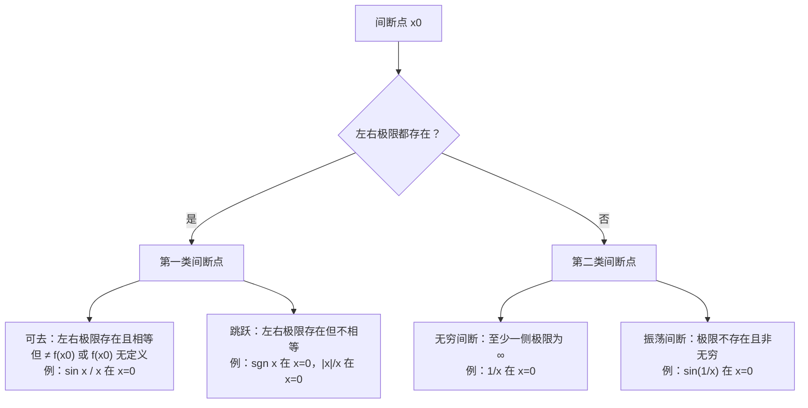

# 无穷小、无穷大与连续

> **考纲定位（数一）**：理解无穷小量、无穷大量的概念，掌握无穷小量的比较方法，会用等价无穷小量求极限；理解函数连续性的概念（含左连续与右连续），会判别函数间断点的类型；了解连续函数的性质和初等函数的连续性，理解闭区间上连续函数的性质（有界性、最大值和最小值定理、介值定理），并会应用这些性质。选择题直接考概念辨析（无穷大 vs 无界、间断点分类），计算题把等价替换当基本功，证明题最爱零点定理与介值定理。
> 前置：[界与函数](functions-and-bounds.md)（函数记号）、[数列与函数极限](02-03-sequence-function-limits.md)（极限语言、两个重要极限、$1^\infty$ 快算法）。后续：[极限计算方法综合](06-limit-techniques.md)。导航：[高等数学总览](../calculus.md)。

**目录**

- [一、无穷小与无穷大](#一无穷小与无穷大)：[概念与相互关系](#11-概念与相互关系) · [运算性质](#12-无穷小的运算性质) · [阶的比较](#13-无穷小的比较) · [等价替换](#14-等价无穷小替换)
- [二、函数的连续性](#二函数的连续性)：[连续的定义](#21-连续的定义) · [间断点分类](#22-间断点及其分类) · [运算与初等函数的连续性](#23-连续函数的运算与初等函数的连续性)
- [三、闭区间上连续函数的性质](#三闭区间上连续函数的性质)：[有界性与最值](#31-有界性与最值定理) · [零点定理与介值定理](#32-零点定理与介值定理) · [存在性证明套路](#33-存在性证明套路)
- [四、题型与方法总结](#四题型与方法总结)
- [五、易错点清单](#五易错点清单)
- [六、与其他笔记的联系](#六与其他笔记的联系)
- [附：自测清单](#附自测清单)

## 一、无穷小与无穷大

### 1.1 概念与相互关系

> **定义（无穷小）** 若 $\lim\limits_{x\to x_0}\alpha(x)=0$（或 $x\to\infty$ 等任一极限过程），则称 $\alpha(x)$ 是该极限过程中的**无穷小**。
> **定义（无穷大）** 若对任意 $M>0$，存在 $\delta>0$，当 $0<|x-x_0|<\delta$ 时 $|f(x)|>M$，则称 $f$ 是 $x\to x_0$ 时的**无穷大**，记 $\lim\limits_{x\to x_0}f(x)=\infty$。

逐条辨析（选择题字眼题的高发区）：

- **都是"过程"而不是"数"**：无穷小/无穷大描述极限行为。$0$ 是唯一可以作为无穷小的常数（它的极限恰为 $0$）；$10^{-100}$ 再小也不是无穷小，$10^{100}$ 再大也不是无穷大。
- **去心**：无穷大定义用 $0<|x-x_0|<\delta$——$f$ 在 $x_0$ 点本身取什么值无关紧要。
- **无穷大是"极限不存在的定述"**：$\lim f=\infty$ 按定义极限并不存在，只是用 $\infty$ 记录发散方式。$\infty$ 不是数，不能写 $f(x_0)=\infty$ 参与四则运算。
- **倒数关系**：同一极限过程中，$f$ 为无穷大 $\iff$ $\dfrac1f$ 为无穷小（$f$ 在某去心邻域内不为 $0$）；非零无穷小 $\alpha$ 的倒数 $\dfrac1\alpha$ 为无穷大。做题时"分子分母同颠倒"的底气全在这里。
- **无穷大 vs 无界**（高频辨析）：无穷大 $\Rightarrow$ 无界，反之不成立。经典反例 $f(x)=x\sin x$ 在 $\mathbb{R}$ 上无界（取 $x_n=n\pi+\dfrac\pi2$，$f(x_n)=x_n\to\infty$），但 $x\to\infty$ 时不是无穷大（取 $y_n=n\pi$，$f(y_n)=0$，总有不满足 $|f|>M$ 的点）。**无穷大要求"最终全体"变大，无界只要求"存在点列"变大。**

### 1.2 无穷小的运算性质

| 运算 | 结论 | 备注 |
|------|------|------|
| 有限个无穷小之和 | 无穷小 | **无限个不成立**：$n\cdot\dfrac1n=1$ |
| 有限个无穷小之积 | 无穷小 | |
| 有界函数 × 无穷小 | 无穷小 | $\lim\limits_{x\to0}x\sin\dfrac1x=0$、$\lim\limits_{x\to\infty}\dfrac{\sin x}x=0$ 的依据 |
| 常数 × 无穷小 | 无穷小 | |
| 无穷小 ÷ 无穷小 | **不定** | 阶的比较（下节）专门处理它 |

"有界 × 无穷小 = 无穷小"是最常被忽视的工具：看到 $\sin\dfrac1x$、$\cos x$（$x\to\infty$）这类**自身无极限但有界**的因子，先圈出来——它和无穷小因子相乘直接清零，根本不用求它的极限。

### 1.3 无穷小的比较

设同一极限过程中 $\alpha$、$\beta$ 都是无穷小，且 $\beta\ne0$（在某去心邻域内）：

| 名称 | 条件（$\lim\dfrac\alpha\beta=$） | 记号 | 直觉 |
|------|------|------|------|
| 高阶 | $0$ | $\alpha=o(\beta)$ | $\alpha$ 跑得快得多 |
| 低阶 | $\infty$ | $\beta=o(\alpha)$ | 反过来 |
| 同阶 | $C\ne0$ | — | 一样快，倍数不同 |
| $k$ 阶 | $\lim\dfrac\alpha{\beta^k}=C\ne0$（$\beta$ 为基准） | — | 以基准的幂次定刻度 |
| 等价 | $1$ | $\alpha\sim\beta$ | 一样快且倍数为 1 |

- **核心恒等式**：$\alpha\sim\beta\iff\alpha=\beta+o(\beta)$（相差一个更高阶无穷小）。等价不是相等，是"差掉的部分可以忽略"——这句话是加减替换全部争议的裁判。
- 定阶例（$x\to0$，基准 $x$）：$1-\cos x$ 是 **2 阶**（$\sim\dfrac{x^2}2$）；$x-\sin x$ 是 **3 阶**（$\sim\dfrac{x^3}6$）；$\sqrt{1+x}-1$ 是 **1 阶**（$\sim\dfrac x2$）。

### 1.4 等价无穷小替换

> **替换定理**：设 $\alpha\sim\alpha'$，$\beta\sim\beta'$，且 $\lim\dfrac{\alpha'}{\beta'}$ 存在（或为 $\infty$），则 $\lim\dfrac\alpha\beta=\lim\dfrac{\alpha'}{\beta'}$。

**必背等价表**（全部指 $x\to0$；括号内是三阶补充，泰勒展开的预告）：

| 一阶（8 条） | 二阶 | 三阶（4 条） |
|---|---|---|
| $\sin x\sim x$ | $1-\cos x\sim\dfrac{x^2}2$ | $x-\sin x\sim\dfrac{x^3}6$ |
| $\tan x\sim x$ | $x-\ln(1+x)\sim\dfrac{x^2}2$ | $\tan x-x\sim\dfrac{x^3}3$ |
| $\arcsin x\sim x$ | | $\tan x-\sin x\sim\dfrac{x^3}2$ |
| $\arctan x\sim x$ | | $x-\arctan x\sim\dfrac{x^3}3$ |
| $\ln(1+x)\sim x$ | | |
| $e^{x}-1\sim x$ | | |
| $a^{x}-1\sim x\ln a$ | | |
| $(1+x)^{\alpha}-1\sim\alpha x$ | | |

（三阶条的来历示例：$\tan x-\sin x=\tan x\,(1-\cos x)\sim x\cdot\dfrac{x^2}2=\dfrac{x^3}2$——两条一阶二阶等价的乘积。）

**替换的纪律：乘除可换，加减保阶。**

- **因式中（乘除）可自由替换**：定理保证。
- **加减中不能各自替换，除非替换后主部不相消**：若把 $\tan x-\sin x$ 里的 $\tan x$、$\sin x$ 都换成 $x$，得 $x-x=0$，把三阶真值 $\dfrac{x^3}2$ 算没了——错误根源：两个等价只保证"各自与主部差高阶"，相减后主部消掉，剩下的恰是那被忽略的高阶部分。安全做法二选一：
  1. **提公因子**化成乘积结构（如 $\tan x-\sin x=\tan x(1-\cos x)$）再替换；
  2. **用已知的高阶等价**（表的三阶列）或泰勒展开（[极限计算方法综合](06-limit-techniques.md) §3.2 的主题）。

**例 1（核对）**：$\lim\limits_{x\to0}\dfrac{e^{x^2}-\cos x}{x^2}$。分子加减但主部不消：$e^{x^2}-\cos x=(e^{x^2}-1)+(1-\cos x)\sim x^2+\dfrac{x^2}2=\dfrac32x^2$，故极限为 $\dfrac32$。∎

**例 2（核对）**：$\lim\limits_{x\to0}\dfrac{\tan x-\sin x}{x^3}=\lim\dfrac{x^3/2}{x^3}=\dfrac12$（直接用三阶条；或提公因子 $\tan x(1-\cos x)$）。若各自替换得 $0$ 就是典型错误。∎

**例 3（核对）**：$\lim\limits_{x\to0}\dfrac{\sin x-x\cos x}{x^3}$。分母 $x^3$ 提示三阶：$\sin x-x\cos x=(\sin x-x)+x(1-\cos x)\sim-\dfrac{x^3}6+\dfrac{x^3}2=\dfrac{x^3}3$，极限 $\dfrac13$。（注意 $\sin x-x\sim-\dfrac{x^3}6$ 带负号——拆项后各自保阶，符号要跟着搬。）∎

**例 4（核对，衔接 $1^\infty$ 快算法）**：$\lim\limits_{x\to0}(\cos x)^{1/x^2}$。$\cos x=1+(\cos x-1)$，指数 $\psi=\dfrac1{x^2}$，$\psi(\varphi-1)=\dfrac{\cos x-1}{x^2}\to-\dfrac12$，故极限 $=e^{-1/2}$。∎

## 二、函数的连续性

### 2.1 连续的定义

三种等价表述（考纲要求理解，含左、右连续）：

$$
\textbf{增量式：}\ \lim_{\Delta x\to0}\Delta y=0;\qquad
\textbf{极限式：}\ \lim_{x\to x_0}f(x)=f(x_0);\qquad
\textbf{ε-δ：}\ \forall\varepsilon>0\ \exists\delta>0:\ |x-x_0|<\delta\Rightarrow|f(x)-f(x_0)|<\varepsilon.
$$

- **三要素**：$f(x_0)$ 有定义；$\lim\limits_{x\to x_0}f(x)$ 存在；二者相等。缺一即间断。
- **与极限定义的唯一差别**：极限用去心邻域 $0<|x-x_0|<\delta$（不看点本身），连续的 ε-δ **不去心**（$|x-x_0|<\delta$）——连续必须管上 $x_0$ 这一点的函数值。
- **左连续**：$f(x_0^-)=f(x_0)$；**右连续**：$f(x_0^+)=f(x_0)$。$f$ 在 $x_0$ 连续 $\iff$ 既左连续又右连续。
- **区间上的连续**：在开区间每点连续；闭区间端点只要**单侧**连续（$[a,b]$ 上：$a$ 处右连续、$b$ 处左连续）。

### 2.2 间断点及其分类

设 $f$ 在 $x_0$ 的某去心邻域内有定义，若 $x_0$ 不是连续点，则称为**间断点**。以**左右极限是否存在**为第一刀：

- **"可去"的含义**：只需（重新）定义 $f(x_0)=$ 该点极限值，函数就在该点连续——间断是"形式上"的。$x\sin\dfrac1x$ 在 $x=0$ 处极限为 $0$，补充定义 $f(0)=0$ 即连续，属可去间断。
- 判别 $e^{1/x}$ 型记得分左右（[02-03](02-03-sequence-function-limits.md) §3.2 的表）：$x\to0^-$ 时 $e^{1/x}\to0$、$x\to0^+$ 时 $\to+\infty$，右极限不存在 $\Rightarrow$ 第二类。

**例（核对，分类大题）**：讨论 $f(x)=\dfrac{x^2-x}{|x|(x^2-1)}$ 的间断点。

$x=0,\ \pm1$ 处无定义。化简（$x\ne0,\pm1$）：$f(x)=\dfrac{x(x-1)}{|x|(x-1)(x+1)}=\dfrac{\operatorname{sgn}x}{x+1}$。

- $x\to0$：左极限 $-1$、右极限 $1$，存在但不等 $\Rightarrow$ **跳跃**（第一类）。
- $x\to1$：极限 $\dfrac12$，但 $f(1)$ 无定义 $\Rightarrow$ **可去**（第一类）；补充定义 $f(1)=\dfrac12$ 即连续。
- $x\to-1$：分子 $\operatorname{sgn}x=-1$ 附近恒负，分母 $x+1\to0$，$\left|f\right|\to+\infty$ $\Rightarrow$ **无穷间断**（第二类）。∎

### 2.3 连续函数的运算与初等函数的连续性

| 运算 | 结论 |
|------|------|
| 四则 | $f,g$ 在 $x_0$ 连续 $\Rightarrow$ $f\pm g$、$fg$、$\dfrac fg$（$g(x_0)\ne0$）都在 $x_0$ 连续 |
| 复合 | $g$ 在 $x_0$ 连续、$f$ 在 $g(x_0)$ 连续 $\Rightarrow$ $f\circ g$ 在 $x_0$ 连续 |
| 反函数 | 区间上单调连续的函数，其反函数在对应区间上单调连续（主值区间的根基，见 [界与函数](functions-and-bounds.md) §2.1） |

复合连续性的**极限版推论**（更好用）：若 $\lim\limits_{x\to x_0}g(x)=u_0$（去心，$g$ 可以不连续）且 $f$ 在 $u_0$ 连续，则

$$\lim_{x\to x_0}f(g(x))=f\left(\lim_{x\to x_0}g(x)\right)$$

——**外层连续，极限号就能穿进函数**。这是"代入法"求极限的合法性来源。

> **定理**：基本初等函数在其定义域上连续；**初等函数在其定义区间内连续**（定义区间 = 定义域内的区间部分，孤立点不算）。

应用：初等函数求定义区间内的极限**直接代入**即可，如 $\lim\limits_{x\to2}\dfrac{e^x+\ln(x^2+1)}{\sin x}$——代入 $x=2$ 完事。分段函数的分界点、无定义点是仅有的两处需要单独处理的地方。

（一致连续：数一考纲不要求，知道名词即可——闭区间上连续函数自动一致连续（Cantor 定理），此处不展开。）

## 三、闭区间上连续函数的性质

以下四定理都要求**闭区间 + 连续**两个条件，缺一不可。

### 3.1 有界性与最值定理

> **有界性定理**：$f\in C[a,b]$ $\Rightarrow$ $f$ 在 $[a,b]$ 上有界。
> **最值定理**：$f\in C[a,b]$ $\Rightarrow$ 存在 $\xi_1,\xi_2\in[a,b]$ 使 $f(\xi_1)=M=\max f$、$f(\xi_2)=m=\min f$。

- 证明思路（了解）：有界性反证 + 有限覆盖/[致密性](02-03-sequence-function-limits.md#24-子列与子列极限)（把"无界点列"压缩出一个收敛子列，与连续性矛盾）；构造性做法则是[闭区间套二分法](functions-and-bounds.md#14-闭区间套定理)。数一不考证明，考**反例与用法**。
- **条件失效的反例**（选择题）：开区间不行——$\dfrac1x\in C(0,1)$ 无界；有间断点不行——$f(x)=\begin{cases}\dfrac1x,&x\ne0\\ 0,&x=0\end{cases}$ 在 $[-1,1]$ 上无界；闭而不连续也取不到最值——$f(x)=x$ 在 $[0,1)$ 上无最大值。
- 与 [界与函数](functions-and-bounds.md) 的呼应：$\sup$/$\inf$ 只承诺"最小上界存在"，**闭区间上连续才进一步保证被取到**（$\max$ 是被取到的上确界）。

### 3.2 零点定理与介值定理

> **零点定理（根的存在定理）**：$f\in C[a,b]$ 且 $f(a)\cdot f(b)<0$ $\Rightarrow$ $\exists\,\xi\in(a,b)$，$f(\xi)=0$。
> **介值定理**：$f\in C[a,b]$，则对介于 $f(a)$、$f(b)$ 之间的任一值 $C$，$\exists\,\xi\in(a,b)$ 使 $f(\xi)=C$。

- **介值定理由零点定理推出**：构造 $F(x)=f(x)-C$，则 $F(a)$、$F(b)$ 异号。
- **与最值定理联用的推论（值域刻画）**：$f\in C[a,b]$ $\Rightarrow$ $f([a,b])=[m,M]$——闭区间上连续函数把值域填成一个**闭区间**。由此：介于 $m$、$M$ 之间的任何值都被取到（即使超出 $f(a)$、$f(b)$ 的范围）。
- 几何直觉：连续曲线从 $f(a)$ 走到 $f(b)$ 不抬笔，中途每个高度都必须经过。

### 3.3 存在性证明套路

**套路模板**：① 把结论改写成 $F(\xi)=0$（移项构造辅助函数）；② 找两个点使 $F$ 异号（常选区间端点、$0$、构造的特殊点）；③ 零点定理收尾；④ 端点恰好为零时单独讨论。

**例 1（核对）**：证明方程 $x=a\sin x+b$（$a>0,b>0$）至少有一个正根，且不超过 $a+b$。

令 $F(x)=x-a\sin x-b$，连续。$F(0)=-b<0$；$F(a+b)=a+b-a\sin(a+b)-b=a\,[1-\sin(a+b)]\ge0$（$\sin\le1$）。
若 $F(a+b)=0$，则 $x=a+b$ 即为根；否则 $F(0)\cdot F(a+b)<0$，由零点定理存在 $\xi\in(0,a+b)$ 使 $F(\xi)=0$。∎

**例 2（核对）**：$f\in C[0,1]$ 且 $f(0)=f(1)$，证明存在 $\xi\in\left[0,\tfrac12\right]$ 使 $f(\xi)=f\left(\xi+\tfrac12\right)$。

令 $F(x)=f(x)-f\left(x+\tfrac12\right)$，在 $\left[0,\tfrac12\right]$ 上连续。$F(0)=f(0)-f\left(\tfrac12\right)$，$F\left(\tfrac12\right)=f\left(\tfrac12\right)-f(1)=f\left(\tfrac12\right)-f(0)$，两者互为相反数：$F(0)\cdot F\left(\tfrac12\right)=-F(0)^2\le0$。若 $=0$ 则 $\xi=0$ 或 $\tfrac12$ 即可；否则异号，零点定理给出 $\xi\in\left(0,\tfrac12\right)$。∎

**例 3（核对，介值 + 最值）**：$f\in C[a,b]$，$c,d\in[a,b]$，证明存在 $\xi\in[a,b]$ 使 $f(\xi)=\dfrac{f(c)+f(d)}2$。

由最值定理设 $m\le f(x)\le M$。则 $m\le\dfrac{f(c)+f(d)}2\le M$（两个 $[m,M]$ 内的数的平均仍在 $[m,M]$ 内）。由值域刻画 $f([a,b])=[m,M]$，该平均值必被取到。∎（把 $\dfrac12$ 换成任意的凸组合 $\lambda f(c)+(1-\lambda)f(d)$、或 $n$ 个点的平均，论证一字不改。）

## 四、题型与方法总结

| 目标 | 方法 | 信号 |
|------|------|------|
| 判断无穷小/无穷大/无界 | 回定义；"全体 vs 点列"辨析；倒数关系 | 选择题"下列说法正确的是" |
| 比较阶 / 定 $k$ 阶 | 算 $\lim\frac\alpha\beta$；套等价表 | "同阶、等价、$k$ 阶无穷小" |
| $\dfrac00$ 型极限 | 等价替换：因式自由换，加减先保阶 | $\sin$、$\tan$、$\ln$、$e$、幂结构 |
| $1^\infty$ 型 | $e^{\lim\psi(\varphi-1)}$，配合等价替换 | 底 $\to1$、指数 $\to\infty$ |
| 间断点判别与分类 | 找无定义点/分段点 → 算左右极限 → 分类树 | "指出间断点类型并说明理由" |
| 补充定义使连续 | 求该点极限值（常用等价替换），令 $f(x_0)=$ 极限值 | "可去间断" |
| 证明方程有根 / 存在 $\xi$ | 构造 $F$ + 零点定理；涉及具体数值用最值 + 介值（值域刻画） | "至少存在一点 $\xi$" |

## 五、易错点清单

- **$0$ 是无穷小；任何非零常数都不是**（再小也不是）。
- **无穷多个无穷小之和不一定是无穷小**（$n\cdot\frac1n=1$）。
- **无界 $\not\Rightarrow$ 无穷大**（$x\sin x$ 反例）；无穷大 $\Rightarrow$ 无界。
- **加减中各自替换**是最高频计算错误：$\tan x-\sin x\ne x-x$——要么提公因子，要么用三阶等价/泰勒。
- 等价替换只保证**比值极限不变**，不保证等式成立；$\sin x\sim x$ 但 $\sin x\ne x$。
- **连续三要素**缺一即间断：可去间断是"极限在、函数值缺席或对不上"，不是"没有极限"。
- **间断分类第一刀看左右极限是否存在**，不是看极限是否为 $\infty$（左右都为 $\infty$ 也是第二类，但要先过"存在与否"这一刀）。
- **"初等函数在其定义区间内连续"**——不是"定义域内"（定义域可含孤立点，孤立点谈不上连续）。
- 闭区间连续函数四定理的**两个条件缺一不可**，反例：$\dfrac1x$ 于 $(0,1)$（开）、$[0,1]$ 上带 $0$ 处间断的版本。
- 零点定理要 $f(a)f(b)<0$ **严格异号**；验证端点时若端点本身为零（如例 1 的 $F(a+b)=0$ 可能成立）要单独成段。
- **连续 ≠ 极限存在**：极限存在 + 等于函数值才连续；可导 ⇒ 连续，连续 ⇏ 可导（[导数概念与求导法则](07-derivative.md) 展开）。

## 六、与其他笔记的联系

- [数列与函数极限](02-03-sequence-function-limits.md) —— 前置：极限语言、$1^\infty$ 快算法在本文 §1.4 例 4 重用；Heine 定理的振荡反例 $\sin\frac1x$ 在本文落成"振荡间断"。
- [界与函数](functions-and-bounds.md) —— 有界性与 $\sup/\inf$ 的语言；最值定理是"确界被取到"的条件。
- [inequalities](../inequalities.md) —— 存在性证明中估计 $F$ 的符号（如 $\sin\le1$ 的放缩）。
- 后续 [06-limit-techniques](06-limit-techniques.md) —— 泰勒展开是"加减保阶"的严格化，等价表是其零阶/一阶截断；章级复习见 [ch1-review](ch1-review.md)。
- [07-derivative](07-derivative.md) —— 可导 ⇒ 连续（逆不真：$\lvert x\rvert$ 在 $0$ 连续不可导）；间断点是不可导的第一嫌疑。
- [单调有界定理](../../../notes/monotone-bounded-convergence.md) —— 同属 Ch1 理论工具，管收敛性；本文四定理管"闭区间上的取值"。

## 附：自测清单

- [ ] 能叙述无穷小/无穷大的定义，并解释"无穷小是过程不是数"、$0$ 为何是无穷小
- [ ] 能说出无穷大与无界的差别，并用 $x\sin x$ 完成反例论证
- [ ] 能默写等价表一阶 8 条 + 二阶 2 条 + 三阶 4 条，注明适用过程是 $x\to0$
- [ ] 能解释"乘除可换、加减保阶"的道理（等价 = 主部 + 高阶误差），并算对 $\frac{\tan x-\sin x}{x^3}$ 与 $\frac{\sin x-x\cos x}{x^3}$
- [ ] 能默画间断点分类树，并完整分类 $\frac{x^2-x}{|x|(x^2-1)}$ 的三个间断点
- [ ] 能写出连续的三种定义并指出与极限定义"去心/不去心"的差别
- [ ] 能叙述闭区间连续函数四大定理，各举一个条件失效的反例
- [ ] 能独立完成 $x=a\sin x+b$ 与 $f(\xi)=f(\xi+\frac12)$ 两道存在性证明（含端点为零的讨论）
