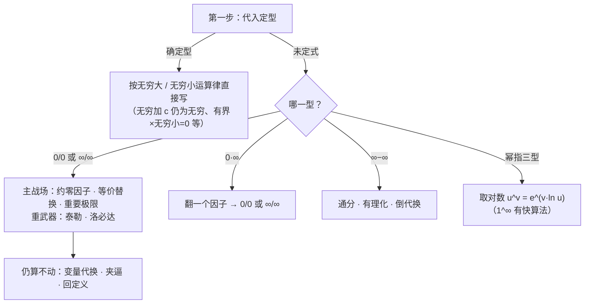

# 极限计算方法综合

> **考纲定位（数一）**：极限计算没有独立的考纲条目，却是全卷使用频率最高的单项能力——直接出现在选择、填空里，又藏在渐近线（Ch2）、变限积分与定积分定义（Ch3）、反常积分与级数判敛（Ch8）中。本文是 Ch1 的收官单元：把 01–05 学过的工具整理成「**先定型、再转化、后选法**」的决策体系；泰勒与洛必达属 Ch2 内容（`10-taylor-formula`、`11-lhopital`），此处预置用法与纪律，学到后回填深化。
> 前置：[数列与函数极限](02-03-sequence-function-limits.md)（重要极限、两准则、Heine）、[无穷小、无穷大与连续](04-05-infinitesimal-continuity.md)（等价替换纪律）。章级复习配合 [Ch1 复习页](ch1-review.md)。导航：[高等数学总览](../calculus.md)。

**目录**

- [一、总览：先定型，再选法](#一总览先定型再选法)：[三步流程](#11-三步流程) · [七种未定式](#12-七种未定式与标准转化) · [轻武器优先原则](#13-轻武器优先原则)
- [二、确定型：定型即止的极限](#二确定型定型即止的极限)：[代入法](#21-代入法及其合法性) · [无穷大与无穷小的运算律](#22-无穷大与无穷小的运算律) · [两类定型陷阱](#23-两类定型陷阱)
- [三、主战场：零比零与无穷比无穷](#三主战场零比零与无穷比无穷)：[轻武器四件套](#31-轻武器四件套) · [泰勒展开法](#32-泰勒展开法) · [洛必达法则](#33-洛必达法则) · [抓大头](#34-无穷比无穷与抓大头)
- [四、其余五型：标准转化路线](#四其余五型标准转化路线)：[零乘无穷](#41-零乘无穷翻一个因子) · [无穷减无穷](#42-无穷减无穷通分有理化与倒代换) · [幂指三型](#43-幂指三型取对数是万能钥匙)
- [五、数列极限专项](#五数列极限专项)
- [六、参数反问题](#六参数反问题)
- [七、题型与方法总结](#七题型与方法总结)
- [八、易错点清单](#八易错点清单)
- [九、与其他笔记的联系](#九与其他笔记的联系)
- [附：自测清单](#附自测清单)

## 一、总览：先定型，再选法

### 1.1 三步流程

1. **定型**：把自变量的趋势代进去看各项的行为。结果是确定型（§二）就直接写答案；只有**未定式**才继续往下走。
2. **转化**：七种未定式中只有 $\dfrac00$ 与 $\dfrac\infty\infty$ 是主战场（§三），其余五种都有标准转化路线（§四），转化后仍回到主战场。
3. **选法**：轻武器优先——代数变形、等价替换、重要极限通常三行内解决；重武器（泰勒、洛必达，Ch2 后解锁）殿后。

### 1.2 七种未定式与标准转化

| 型 | 名称 | 标准转化 | 首选工具 |
|------|------|---------|---------|
| $\dfrac00$ | 零比零 | 直接进主战场 | 等价替换 → 泰勒 → 洛必达 |
| $\dfrac\infty\infty$ | 无穷比无穷 | 直接进主战场 | 抓大头（多项式）· 洛必达 |
| $0\cdot\infty$ | 零乘无穷 | 翻一个因子 | 化 $\dfrac00$ 或 $\dfrac\infty\infty$ 后按上行 |
| $\infty-\infty$ | 无穷减无穷 | 通分 / 有理化 / 倒代换 | 化成 $\dfrac00$ 或 $\dfrac\infty\infty$ |
| $1^\infty$ | 一的无穷次方 | 快算法 $e^{\lim\psi(\varphi-1)}$ | 等价替换配合（[两个重要极限](../../../notes/two-important-limits.md)） |
| $0^0$、$\infty^0$ | 幂指不定型 | $u^v=e^{v\ln u}$ | 化为指数上的 $0\cdot\infty$ |

前四型是**差与商**的极限，后三型是**幂指**的极限——幂指型必须先取对数（或用快算法）把信息搬进指数，绝不能对底数与指数分别取极限（四则运算法则管不到幂指，见 [§八](#八易错点清单)）。

### 1.3 轻武器优先原则

洛必达放在最后不是仪式感，有两条实际理由：

- **它对振荡结构失效**：$\lim\limits_{x\to+\infty}\dfrac{x+\sin x}{x}=1$，但洛一次得 $1+\cos x$ 无极限，法则条件被破坏（§3.3）。
- **它不降复杂度**：$e^x-e^{\sin x}$ 这类同结构相减，洛后依旧纠缠；泰勒或替换几行解决。

等价替换与代数变形先行，泰勒在「分母幂次明确 / 主部相消」时是主力（它就是 [04-05 等价替换纪律](04-05-infinitesimal-continuity.md#14-等价无穷小替换)的严格化：等价表即泰勒的最低阶截断）。

## 二、确定型：定型即止的极限

### 2.1 代入法及其合法性

初等函数在其**定义区间**内连续（[04-05 §2.3](04-05-infinitesimal-continuity.md#23-连续函数的运算与初等函数的连续性)），所以定义区间内一点的极限**直接代入**：

$$\lim_{x\to2}\frac{e^x+\ln(x^2+1)}{\sin x}=\frac{e^2+\ln 5}{\sin 2}\quad(\text{核对：全部为初等运算，代入即得}).$$

真正需要动用工具的只有三类位置：**无定义点、分段点、无穷远**。拿到极限题先确认自己处在三类点之一，否则代入收工。

### 2.2 无穷大与无穷小的运算律

| 运算（同一极限过程） | 结果 | 依据 |
|------|------|------|
| $\infty\pm c$、$\infty+\infty$ | $\infty$ | 无穷大定义（$\infty-\infty$ 除外） |
| $c\cdot\infty$（$c\ne0$） | $\infty$（带 $c$ 的符号） | 定义 |
| $\dfrac{c}{\infty}$（$c$ 为常数） | $0$ | 倒数关系 |
| 有界 × 无穷小 | $0$ | [04-05 §1.2](04-05-infinitesimal-continuity.md#12-无穷小的运算性质) |

三条**不是**确定型的警示：$\infty\times$有界（$x\sin x$ 无界但不趋于无穷）、$\infty-\infty$、$0\times\infty$——它们都是未定式，必须走 §三、§四的流程。

### 2.3 两类定型陷阱

**（1）极限过程决定型**。同一表达式换个过程，型完全不同：

$$\lim_{x\to0}\frac{\sin x}{x}=1\ (\tfrac00\ \text{型，第一重要极限}),\qquad \lim_{x\to\infty}\frac{\sin x}{x}=0\ (\text{有界比无穷，确定型}).$$

看到 $\sin$、$\cos$、$\arctan$ 先问自己在哪个过程；$x\to\infty$ 时它们是**有界因子**，配无穷小直接清零：$\lim\limits_{x\to0}x^2\sin\dfrac1x=0$、$\lim\limits_{x\to+\infty}\dfrac{x+\sin x}{x}=\lim\limits_{x\to+\infty}\left(1+\dfrac{\sin x}{x}\right)=1$（核对：$\left|\dfrac{\sin x}x\right|\le\dfrac1x\to0$，夹逼）。

**（2）单侧不对称型必须分侧定型**。$x\to0$ 时的 $e^{1/x}$、$\arctan\dfrac1x$ 左右两侧行为不同（左右极限表见 [02-03 §3.2](02-03-sequence-function-limits.md)）：$e^{1/x}$ 左侧趋于 $0$、右侧趋于 $+\infty$——两侧连**型**都不一样，必须分别处理后再用「单侧合一」判定。

## 三、主战场：零比零与无穷比无穷

### 3.1 轻武器四件套

**（1）约零因子**——因式分解，消去造出零的公因子：

**例（核对）**：$\lim\limits_{x\to1}\dfrac{x^2-1}{x^2-3x+2}=\lim\limits_{x\to1}\dfrac{(x-1)(x+1)}{(x-1)(x-2)}=\dfrac{2}{-1}=-2$。∎

**（2）有理化**——根式差乘共轭，把根号下的零因子请出来：

**例（核对）**：$\lim\limits_{x\to0}\dfrac{\sqrt{1+x}-\sqrt{1-x}}{x}=\lim\limits_{x\to0}\dfrac{2x}{x\left(\sqrt{1+x}+\sqrt{1-x}\right)}=\dfrac{2}{2}=1$。∎（$x\to\infty$ 的根式差属 $\infty-\infty$ 型，见 §4.2。）

**（3）两个重要极限**——把式子恒等变形凑出 $\dfrac{\sin\square}{\square}$ 或 $\left(1+\square\right)^{1/\square}$，方块趋于 $0$ 且全式同一个方块（弧度制）：

**例（核对）**：$\lim\limits_{x\to0}\dfrac{\sin5x}{\sin3x}=\dfrac53\cdot\dfrac{\sin5x}{5x}\cdot\dfrac{3x}{\sin3x}=\dfrac53$。∎

**（4）等价无穷小替换**——乘除自由、加减保阶（纪律见 [04-05 §1.4](04-05-infinitesimal-continuity.md#14-等价无穷小替换)）：

**例（核对，乘除）**：$\lim\limits_{x\to0}\dfrac{e^{x^2}-1}{1-\cos2x}=\lim\limits_{x\to0}\dfrac{x^2}{\tfrac12(2x)^2}=\dfrac12$。∎

**例（核对，加减但主部不消）**：$\lim\limits_{x\to0}\dfrac{e^x-\cos x}{x}$。恒等拆成两个替换友好的差：$e^x-\cos x=(e^x-1)+(1-\cos x)\sim x+\dfrac{x^2}2$（两个主部**不同阶、不相消**，替换合法），故极限 $=\lim\limits_{x\to0}\left(1+\dfrac x2\right)=1$。∎

加减中主部**相消**时（$\tan x-\sin x$ 若各自换成一阶条得 $0$），一阶等价失效——需要更高阶的精度，进入泰勒。

### 3.2 泰勒展开法

（Ch2 的 `10-taylor-formula` 讲展开的来路与误差理论；此处先用起来。）

**原理**：把函数写成「多项式主部 + 高阶余项」，**分母是几阶，分子就展到几阶**。等价替换表就是各展开的最低阶截断——「加减保阶」问题的终极形态是按需展开到指定阶。

**$x\to0$ 必备展开表**（记到三阶；$\cos$ 需要时用四阶）：

$$e^x=1+x+\frac{x^2}2+\frac{x^3}6+o(x^3),\qquad \sin x=x-\frac{x^3}6+o(x^3),\qquad \cos x=1-\frac{x^2}2+\frac{x^4}{24}+o(x^4),$$

$$\ln(1+x)=x-\frac{x^2}2+\frac{x^3}3+o(x^3),\qquad (1+x)^{\alpha}=1+\alpha x+\frac{\alpha(\alpha-1)}2x^2+o(x^2),$$

$$\tan x=x+\frac{x^3}3+o(x^3),\qquad \arcsin x=x+\frac{x^3}6+o(x^3),\qquad \arctan x=x-\frac{x^3}3+o(x^3).$$

（与 [04-05 等价表](04-05-infinitesimal-continuity.md#14-等价无穷小替换)同源：一阶条是各展开的首项，三阶条是两个展开的差。）

**例 1（核对，展到四阶）**：$\lim\limits_{x\to0}\dfrac{\cos x-e^{-x^2/2}}{x^4}$。分母四阶，两个展开都取到 $x^4$：

$$\cos x=1-\frac{x^2}2+\frac{x^4}{24}+o(x^4),\qquad e^{-x^2/2}=1-\frac{x^2}2+\frac12\left(\frac{x^2}2\right)^2+o(x^4)=1-\frac{x^2}2+\frac{x^4}8+o(x^4).$$

相减（$x^2$ 项相消，$x^4$ 项定值）：$\dfrac{\frac1{24}-\frac18}1=\dfrac{1-3}{24}=-\dfrac1{12}$。∎（数值核对：$x=0.05$ 时比值 $\approx-0.083285$，$-\dfrac1{12}\approx-0.083333$。）

**例 2（核对，展到二阶）**：$\lim\limits_{x\to0}\dfrac{e^x-1-x}{x^2}=\lim\limits_{x\to0}\dfrac{x^2/2+o(x^2)}{x^2}=\dfrac12$。∎（这正是 §3.1 末尾「主部相消」的场景：分子 $e^x-1$ 与 $x$ 的一阶主部相消，必须展到二阶。）

**展到几阶**：目标阶 = 分母（或差的主部）的阶数；展开后主部相消就再升一阶。

### 3.3 洛必达法则

（Ch2 的 `11-lhopital` 给证明与系统训练；先立规矩。）

> **法则**：设 ① $\lim\limits_{x\to x_0}\dfrac{f(x)}{g(x)}$ 是 $\dfrac00$ 或 $\dfrac\infty\infty$ 型；② 在 $x_0$ 的某去心邻域内 $f'(x)$、$g'(x)$ 都存在且 $g'(x)\ne0$；③ $\lim\limits_{x\to x_0}\dfrac{f'(x)}{g'(x)}=A$（或 $\infty$）。则
> $$\lim_{x\to x_0}\frac{f(x)}{g(x)}=\lim_{x\to x_0}\frac{f'(x)}{g'(x)}=A\ (\text{或}\ \infty).$$

三条纪律：

- **先化简再洛**：等价替换、约分、提出非零因子先行。$\dfrac{e^{x^2}-1}{1-\cos2x}$（§3.1 例）替换一步得 $\dfrac12$；硬洛则 $\dfrac{2xe^{x^2}}{2\sin2x}$ 仍是 $\dfrac00$，越洛越长。
- **连用先验型**：每洛一次都要重新确认仍是 $\dfrac00$ 或 $\dfrac\infty\infty$，型没了还洛就是滥用。
- **条件③是单行道**：$\lim\dfrac{f'}{g'}$ 不存在（也不为 $\infty$）时只能说明**这条路走不通**，原极限仍可能存在——换工具，不许下「原极限不存在」的结论。

**例（核对）**：$\lim\limits_{x\to0}\dfrac{x-\sin x}{x^3}$。三连洛（每次都是 $\dfrac00$）：$\dfrac{1-\cos x}{3x^2}\to\dfrac{\sin x}{6x}\to\dfrac{\cos x}{6}=\dfrac16$。∎（泰勒一步同样：$x-\sin x=\dfrac{x^3}6+o(x^3)$。）

**失效例 1（核对）**：$\lim\limits_{x\to+\infty}\dfrac{x+\sin x}{x}$。§2.3 已算出 $=1$；若上洛必达得 $\dfrac{1+\cos x}{1}$ 振荡无极限——条件③不满足，法则失效，但原极限好好存在。∎

**失效例 2（核对）**：$\lim\limits_{x\to0}\dfrac{x^2\sin\frac1x}{\sin x}$。改写 $=x\sin\dfrac1x\cdot\dfrac{x}{\sin x}\to0\cdot1=0$（有界 × 无穷小）；洛一次得 $\dfrac{2x\sin\frac1x-\cos\frac1x}{\cos x}$，分子含 $-\cos\dfrac1x$ 振荡无极限，法则失效。∎

**定位**：洛必达是重武器不是第一反应。它最好用的场景是「求导后明显降阶」的多项式、根式与指数对数混合结构；对同结构相减（$e^x-e^{\sin x}$）、含振荡因子（$\sin\dfrac1x$）的结构要警惕。

### 3.4 无穷比无穷与抓大头

多项式之比：同除最高次幂，逐项取极限（项数**固定**，四则合法）：

**例（核对）**：$\lim\limits_{x\to\infty}\dfrac{3x^3-x}{5x^3+2x^2}=\lim\limits_{x\to\infty}\dfrac{3-\frac1{x^2}}{5+\frac2x}=\dfrac35$。∎

「抓大头」（只看最高次项）是这套流程的心算版；根式混合时同除后再有理化，如 $\lim\limits_{x\to+\infty}\dfrac{\sqrt{x^2+x}}{x}=\lim\limits_{x\to+\infty}\sqrt{1+\dfrac1x}=1$。注意与 [§5 数列 $n$ 项和](#五数列极限专项)的区别：那里**项数随 $n$ 变**，不能逐项取极限。

## 四、其余五型：标准转化路线

### 4.1 零乘无穷：翻一个因子

把其中一个因子翻到分母，化为 $\dfrac00$ 或 $\dfrac\infty\infty$。**翻谁**：让留下的结构求导/替换后更简单——对数、反三角通常留在分子（求导降为幂式），幂函数翻上去。

**例（核对）**：$\lim\limits_{x\to0^+}x\ln x=\lim\limits_{x\to0^+}\dfrac{\ln x}{1/x}\xrightarrow{\text{洛}}\lim\limits_{x\to0^+}\dfrac{1/x}{-1/x^2}=\lim\limits_{x\to0^+}(-x)=0$。∎（翻 $x$ 上去：$\ln x$ 求导得 $\dfrac1x$，干净利落；反之把 $\ln$ 翻上去求导更乱。）

### 4.2 无穷减无穷：通分、有理化与倒代换

**例 1（核对，通分）**：$\lim\limits_{x\to1}\left(\dfrac1{x-1}-\dfrac2{x^2-1}\right)=\lim\limits_{x\to1}\dfrac{x+1-2}{(x-1)(x+1)}=\lim\limits_{x\to1}\dfrac1{x+1}=\dfrac12$。∎

**例 2（核对，有理化）**：$\lim\limits_{x\to+\infty}\left(\sqrt{x^2+x}-x\right)=\lim\limits_{x\to+\infty}\dfrac{x}{\sqrt{x^2+x}+x}=\lim\limits_{x\to+\infty}\dfrac1{\sqrt{1+\frac1x}+1}=\dfrac12$。∎

**例 3（核对，通分 + 泰勒）**：$\lim\limits_{x\to0}\left(\dfrac1{x^2}-\dfrac1{\sin^2x}\right)=\lim\limits_{x\to0}\dfrac{\sin^2x-x^2}{x^2\sin^2x}$。由 $\sin^2x=\dfrac{1-\cos2x}2=x^2-\dfrac{x^4}3+o(x^4)$，分子 $=-\dfrac{x^4}3+o(x^4)$，分母 $=x^4+o(x^4)$，极限 $=-\dfrac13$。∎（数值核对：$x=0.05$ 时原式 $\approx-0.3335$。）

**倒代换** $t=\dfrac1x$ 把 $x\to\infty$ 化为 $t\to0$，适合根式与多项式纠缠的结构（例 2 亦可倒代换验证）。

### 4.3 幂指三型：取对数是万能钥匙

恒等式 $u^v=e^{v\ln u}$（要求邻域内 $u>0$）。三型都走它，其中 $1^\infty$ 另有快算法：

- **$1^\infty$ 快算法**（推导见 [两个重要极限](../../../notes/two-important-limits.md)）：$\varphi\to1$、$\psi\to\infty$ 时 $\varphi^\psi\to e^{\lim\psi(\varphi-1)}$。

  **例（核对）**：$\lim\limits_{x\to0}\left(\dfrac{\sin x}{x}\right)^{1/x^2}$。$\dfrac{\sin x}x=1-\dfrac{x^2}6+o(x^2)$，故 $\psi(\varphi-1)=\dfrac1{x^2}\left(-\dfrac{x^2}6+o(x^2)\right)\to-\dfrac16$，极限 $=e^{-1/6}$。∎（数值核对：$x=0.05$ 时值 $\approx0.84647$，$e^{-1/6}\approx0.84648$。）

- **$0^0$**：**例（核对）** $\lim\limits_{x\to0^+}x^x=\lim\limits_{x\to0^+}e^{x\ln x}=e^0=1$（指数用了 §4.1 的结果）。∎
- **$\infty^0$**：**例（核对）** $\lim\limits_{x\to+\infty}x^{1/x}=\lim\limits_{x\to+\infty}e^{\frac{\ln x}{x}}=e^0=1$（$\dfrac{\ln x}x\to0$：洛一次得 $\dfrac1x\to0$，或「幂函数压住对数」）。∎

**边界**：快算法只对 $1^\infty$ 型合法（它依赖底数与 $1$ 之差为无穷小）；$0^0$、$\infty^0$ 老实取对数。

## 五、数列极限专项

### 5.1 方法选择顺序

| 信号 | 方法 | 例 |
|------|------|------|
| 前 $n$ 项和有闭式（等比、裂项、求和公式） | 先求和，再取极限 | $\sum\dfrac1{k(k+1)}\to1$ |
| 提出因子 $\dfrac1n$ 后呈 $f\!\left(\dfrac kn\right)$ 形状 | 定积分定义（Ch3 回填） | $\dfrac1n\sum\sin\dfrac{k\pi}n\to\dfrac2\pi$ |
| 各项可整体放缩出同限上下界 | 夹逼 | $\sqrt[n]{2^n+5^n}\to5$ |
| 递推式 $a_{n+1}=f(a_n)$ | 单调有界三步（[02-03 §4.2](02-03-sequence-function-limits.md#42-单调有界准则)） | $a_{n+1}=\sqrt{2+a_n}\to2$ |
| 奇偶交错 / 判发散 | 子列工具（[02-03 §2.4](02-03-sequence-function-limits.md#24-子列与子列极限)） | $\cos\dfrac{n\pi}3$ 发散 |
| 都不像 | 连续化 $a_n=f(n)$ 转函数极限 | $n\sin\dfrac1n\to1$ |

**为什么 $n$ 项和不能逐项取极限**：四则运算法则只对**固定有限项**成立；和式的项数随 $n$ 增长，「每一项的极限」加起来根本不是同一个和。逐项法的合法版本是定积分定义（黎曼和），那正是 Ch3 的主题。

### 5.2 先求和再取极限

**例（核对）**：$\lim\limits_{n\to\infty}\sum_{k=1}^n\dfrac1{k(k+1)}=\lim\limits_{n\to\infty}\left(1-\dfrac1{n+1}\right)=1$（裂项 $\dfrac1{k(k+1)}=\dfrac1k-\dfrac1{k+1}$）。∎ 等比数列同理：$\sum_{k=1}^n q^k$（$\lvert q\rvert<1$）先求 $\dfrac{q(1-q^n)}{1-q}$ 再取极限。

### 5.3 夹逼

**例（核对）**：$\lim\limits_{n\to\infty}\sqrt[n]{2^n+5^n}$。$5\le\sqrt[n]{2^n+5^n}\le\sqrt[n]{2\cdot5^n}=5\cdot2^{1/n}\to5$，夹逼得 $5$。∎（一般结论：$\sqrt[n]{a_1^n+\cdots+a_m^n}\to\max a_i$——$n$ 次根号下的和，最大项说了算。）

### 5.4 定积分定义

（Ch3 的 `18-definite-integral` 回填严格性；先认识形状。）

$$\lim_{n\to\infty}\frac1n\sum_{k=1}^n f\!\left(\frac kn\right)=\int_0^1f(x)\,dx.$$

**例（核对）**：$\lim\limits_{n\to\infty}\dfrac1n\sum_{k=1}^n\sin\dfrac{k\pi}n=\int_0^1\sin(\pi x)\,dx=\dfrac{2}{\pi}$（原函数 $-\dfrac{\cos\pi x}{\pi}$，代 $0,1$ 得 $\dfrac{2}{\pi}$）。∎（数值核对：$n=2000$ 时和 $\approx0.63662$，$\dfrac2\pi\approx0.63662$。）

**与夹逼的分界**：夹逼只需上下界同限，精度粗，适合「各项难精确、可整体放缩」；积分定义要求每项精确落在 $f\!\left(\dfrac kn\right)\cdot\dfrac1n$ 的格点上。判据：**提出 $\dfrac1n$ 后剩下的是不是 $f\!\left(\dfrac kn\right)$**——是则积分，否则夹逼或先求和。

### 5.5 连续化及其陷阱

**正用**（Heine 归结原则）：若 $\lim\limits_{x\to+\infty}f(x)=A$，则 $a_n=f(n)\to A$。

**例（核对）**：$\lim\limits_{n\to\infty}n\sin\dfrac1n$。设 $f(x)=x\sin\dfrac1x$，$x\to+\infty$ 时令 $t=\dfrac1x\to0^+$，$\dfrac{\sin t}{t}\to1$，故 $f(x)\to1$，从而原极限 $=1$。∎

**陷阱（逆不真）**：$\sin(n\pi)\equiv0$ 收敛，但 $f(x)=\sin(\pi x)$ 当 $x\to\infty$ **无极限**——数列极限存在推不出函数极限存在。连续化失败只说明「此路不通」，不说明数列没有极限。

### 5.6 递推数列与子列

单调有界三步（有界 → 单调 → 递推式取极限解方程）与振荡型递推的处理（奇偶子列 / 压缩）在 [02-03 §4.2](02-03-sequence-function-limits.md#42-单调有界准则)；子列四关系（正向平移、逆否判发散、奇偶拼装、致密性）在 [02-03 §2.4](02-03-sequence-function-limits.md#24-子列与子列极限)。

**例（核对）**：$\cos\dfrac{n\pi}3$ 发散——$n=6k$ 的子列恒为 $\cos2k\pi=1$，$n=6k+3$ 的子列恒为 $\cos(2k\pi+\pi)=-1$，两个子列极限不同。∎

## 六、参数反问题

模式：**极限存在（或等于给定值）+ 参数待定** → 按阶配平。

**例（核对）**：设 $\lim\limits_{x\to0}\dfrac{\sin x-ax}{x^3}$ 存在，求 $a$ 与该极限。

泰勒：$\sin x-ax=(1-a)x-\dfrac{x^3}6+o(x^3)$。分母三阶，分子的一阶主部必须消去：$1-a=0$，$a=1$；此时极限 $=-\dfrac16$。∎（数值核对：$a=1$、$x=0.1$ 时 $\approx-0.16658$。）

洛必达路线亦可：洛一次得 $\dfrac{\cos x-a}{3x^2}$，其存在要求 $\cos x-a\to0$，即 $a=1$，再洛一次 $\dfrac{-\sin x}{6x}\to-\dfrac16$。两条路线共同的要点：**配平要到「主部不消的那一阶」才给出有效约束**，解出参数后回代检验。

## 七、题型与方法总结

| 信号 / 型 | 方法链 | 详见 |
|------|------|------|
| 定义区间内、无分段 | 直接代入 | [§2.1](#21-代入法及其合法性) |
| $\infty$ 参与的确定型 | 无穷大 / 无穷小运算律 | [§2.2](#22-无穷大与无穷小的运算律) |
| 有界因子 × 无穷小 | 直接清零 | [§2.3](#23-两类定型陷阱) |
| $\dfrac00$，多项式 | 约零因子 | [§3.1](#31-轻武器四件套) |
| $\dfrac00$，根式差 | 有理化 | [§3.1](#31-轻武器四件套) |
| $\dfrac00$，三角 / 指对 / 幂结构 | 等价替换 → 泰勒 → 洛必达 | [§3.1–3.3](#三主战场零比零与无穷比无穷) |
| 分母幂次明确 / 主部相消 | 泰勒到指定阶 | [§3.2](#32-泰勒展开法) |
| $\dfrac\infty\infty$，多项式比 | 抓大头（同除最高次） | [§3.4](#34-无穷比无穷与抓大头) |
| $0\cdot\infty$ | 翻一个因子 | [§4.1](#41-零乘无穷翻一个因子) |
| $\infty-\infty$ | 通分 / 有理化 / 倒代换 | [§4.2](#42-无穷减无穷通分有理化与倒代换) |
| $1^\infty$ | $e^{\lim\psi(\varphi-1)}$ | [§4.3](#43-幂指三型取对数是万能钥匙) |
| $0^0$、$\infty^0$ | 取对数 | [§4.3](#43-幂指三型取对数是万能钥匙) |
| $n$ 项和 | 求和 / 夹逼 / 积分定义 | [§5](#五数列极限专项) |
| 递推数列 | 单调有界 / 子列 | [§5.6](#56-递推数列与子列) |
| 含参极限 | 按阶配平 | [§六](#六参数反问题) |

## 八、易错点清单

- **不定型就动手**：先代入定型；确定型（§2.2 运算律）直接写，别把 $\infty+\infty$ 也送去转化。
- **幂指型拆极限**：$\lim u^v\ne(\lim u)^{\lim v}$——四则法则不含幂指，必须取对数或用 $1^\infty$ 快算法。
- **加减各自替换**：主部相消即错（回 [04-05 纪律](04-05-infinitesimal-continuity.md#14-等价无穷小替换)）；相消就升阶用泰勒。
- **洛必达两误**：不验型连洛；$\lim\dfrac{f'}{g'}$ 不存在就断言原极限不存在（条件③单行道，§3.3 两例）。
- **洛前不化简**：能替换、能约分的先做，否则式子越洛越长。
- **$e^{1/x}$、$\arctan\dfrac1x$ 不分左右**：$x\to0$ 时两侧行为（甚至型）都不同。
- **$0^0$ 想当然**：不是 $0$ 也不是「不存在」——$x^x\to1$，老实取对数。
- **$n$ 项和逐项取极限**：项数随 $n$ 变，四则只保证有限项；用求和 / 夹逼 / 积分定义。
- **连续化逆用**：函数极限不存在 ≠ 数列极限不存在（$\sin n\pi$ 反例，§5.5）。
- **夹逼上下界极限不同**：夹而不逼。
- **参数题只配一阶**：配平要到主部不消的那一阶，并回代检验。

## 九、与其他笔记的联系

- [数列与函数极限](02-03-sequence-function-limits.md) —— 定义、两准则、Heine、重要极限：本文一切工具的理论来源。
- [无穷小、无穷大与连续](04-05-infinitesimal-continuity.md) —— 等价表与替换纪律是本文轻武器的弹药库。
- [界与函数](functions-and-bounds.md) —— 函数记号、有界性语言（「有界因子」的判定）。
- [inequalities](../inequalities.md) —— 放缩工具：夹逼的上下界全靠它。
- [Ch1 复习页](ch1-review.md) —— 章级复习与自测（本文题型在 B 卷混合演练）。
- 原子卡：[七种未定式](../../../notes/indeterminate-forms.md) · [幂指式极限](../../../notes/power-form-limit.md) · [n 项和极限](../../../notes/n-sum-limits.md)
- Ch2 预告：`10-taylor-formula`（展开的来路与余项估计）、`11-lhopital`（法则的证明与系统训练）——学到后回填 §3.2 / §3.3 的深化内容。
- Ch3 预告：`18-definite-integral`（§5.4 积分定义的严格化）。

## 附：自测清单

- [ ] 能默写七种未定式及各自的标准转化路线，画出「定型 → 转化 → 选法」决策图
- [ ] 能列出确定型速查表（无穷大运算律、有界 × 无穷小），并说出三条「伪确定型」警示
- [ ] 能默写泰勒展开表（8 个函数，三阶 / 四阶），解释「分母几阶展几阶、主部相消升一阶」
- [ ] 能独立算对：$\dfrac{\cos x-e^{-x^2/2}}{x^4}$、$\dfrac1{x^2}-\dfrac1{\sin^2x}$、$a=1$ 时的 $\dfrac{\sin x-x}{x^3}$
- [ ] 能叙述洛必达三条件，并举出「法则失效但原极限存在」的两个例子
- [ ] 能完成三个转化例：$x\ln x$、$\dfrac1{x-1}-\dfrac2{x^2-1}$、$\sqrt{x^2+x}-x$
- [ ] 能用快算法与取对数分别处理 $\left(\dfrac{\sin x}x\right)^{1/x^2}$、$x^x$、$x^{1/x}$
- [ ] 能对 $n$ 项和在「先求和 / 夹逼 / 积分定义」中正确选择，并算对 $\sqrt[n]{2^n+5^n}$ 与 $\dfrac1n\sum\sin\dfrac{k\pi}n$
- [ ] 能解释连续化为什么不可逆（$\sin n\pi$ 反例），并说明 $n$ 项和为何不能逐项取极限
