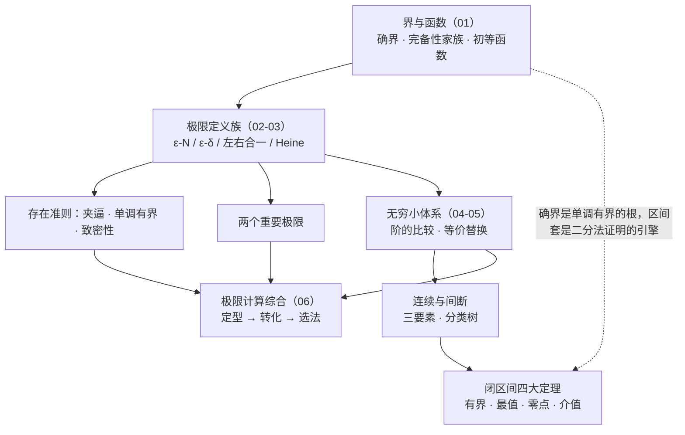

# Ch1 复习 · 函数、极限、连续

> **定位**：Ch1 五篇正文的收官复习页。**不重复正文**，只提供框架图、概念速查、题型总表、反例库、易错点合集与 A/B 两卷自测——内容一律链接回出处。
> **用法**：① 合上正文，对着 [§一框架图](#一知识框架与文件导航)闭卷回忆每个框里有什么 → ② 翻 [§二速查](#二概念速查十一组)补漏 → ③ 限时做 [§六自测](#六自测a-卷与-b-卷)（A 卷约 15 分钟 / B 卷约 90 分钟）→ ④ 错题按出处回正文，隔天复测。
> 导航：[高等数学总览](../calculus.md) · [MOC - math](../../../notes/MOC%20-%20math.md)

**目录**

- [一、知识框架与文件导航](#一知识框架与文件导航)
- [二、概念速查（十一组）](#二概念速查十一组)
- [三、全章题型总表](#三全章题型总表)
- [四、反例库](#四反例库)
- [五、易错点合集](#五易错点合集)
- [六、自测：A 卷与 B 卷](#六自测a-卷与-b-卷)
- [七、三轮复习路线](#七三轮复习路线)
- [八、与其他笔记的联系](#八与其他笔记的联系)

## 一、知识框架与文件导航

| 篇目 | 内容 | 原子卡 |
|------|------|--------|
| [界与函数](functions-and-bounds.md)（01） | 确界与完备性、函数四性质、初等函数、参数方程与极坐标、图形变换 | [闭区间套定理](../../../notes/nested-interval-theorem.md) |
| [数列与函数极限](02-03-sequence-function-limits.md)（02–03） | ε-语言、左右极限、性质、子列与致密性、两准则、Heine、两个重要极限 | [夹逼准则](../../../notes/squeeze-theorem.md) · [单调有界定理](../../../notes/monotone-bounded-convergence.md) · [两个重要极限](../../../notes/two-important-limits.md) · [数列与子列极限](../../../notes/subsequence-limits.md) |
| [无穷小、无穷大与连续](04-05-infinitesimal-continuity.md)（04–05） | 无穷小比较、等价替换、连续与间断分类、闭区间四大定理 | [等价无穷小替换](../../../notes/equivalent-infinitesimals.md) · [间断点分类](../../../notes/discontinuity-classification.md) · [介值定理与零点定理](../../../notes/intermediate-value-theorem.md) |
| [极限计算方法综合](06-limit-techniques.md)（06） | 七种未定式决策、泰勒与洛必达预置、数列极限三法、参数反问题 | [七种未定式](../../../notes/indeterminate-forms.md) · [幂指式极限](../../../notes/power-form-limit.md) · [n 项和极限](../../../notes/n-sum-limits.md) |
| 本文 | 复习与自测 | — |

> 回填区（Ch2/Ch3 学完后回到对应笔记深化）：[06](06-limit-techniques.md) 的泰勒（§3.2）与洛必达（§3.3）、定积分定义（§5.4）。

## 二、概念速查（十一组）

| 组 | 必须能默写的结论 | 详查 |
|----|----------------|------|
| 1. 界与确界 | $\sup E$ 两条：是上界 + 再小一点就不行；$\max$ 是**被取到的**上确界，可以不存在 | [01 §1.1–1.2](functions-and-bounds.md) |
| 2. 完备性家族 | 确界存在 / 单调有界 / 闭区间套 / 致密性 / 有限覆盖，五者等价；推导链：确界 ⇒ 单调有界 ⇒ 区间套 | [01 §1.3–1.4](functions-and-bounds.md) |
| 3. 极限定义 | ε-N / ε-δ / ε-X 三语言；**去心**邻域（与该点函数值无关）；$N$、$\delta$ 依赖 ε 且可放大 | [02-03 §2.1、§3.1、§3.3](02-03-sequence-function-limits.md) |
| 4. 极限四充要 | ε-δ 定义 / 单侧合一 / Heine 数列刻画 / 无穷小分解 $f=A+\alpha$ | [02-03 §3.7](02-03-sequence-function-limits.md) |
| 5. 极限性质 | 唯一；**局部**有界；**局部**保号（$A>0\Rightarrow f>\frac A2$，逆只给 $A\ge0$）；保序但严格号降级为 $\ge$ | [02-03 §2.3、§3.4](02-03-sequence-function-limits.md) |
| 6. 两准则 | 夹逼：两端同限定中间；单调有界：递推三步（有界 → 单调 → 取极限解 $L$）；振荡递推看奇偶子列 | [02-03 §四](02-03-sequence-function-limits.md) |
| 7. 两个重要极限 | $\dfrac{\sin\square}{\square}\to1$、$\left(1+\square\right)^{1/\square}\to e$（$\square\to0$）；$1^\infty$ 快算法 $e^{\lim\psi(\varphi-1)}$ | [02-03 §五](02-03-sequence-function-limits.md) |
| 8. 无穷小体系 | 阶的比较（$k$ 阶 = 比值极限非零）；等价表 8+2+4 条（$x\to0$）；**乘除可换、加减保阶**；无穷大 ⇒ 无界，逆不真 | [04-05 §一](04-05-infinitesimal-continuity.md) |
| 9. 连续与间断 | 三要素：有定义、极限存在、相等；分类第一刀**看左右极限是否存在**（第一类：可去 / 跳跃；第二类：无穷 / 振荡）；初等函数在**定义区间**内连续，极限号可穿过连续的外层 | [04-05 §二](04-05-infinitesimal-continuity.md) |
| 10. 闭区间四大定理 | 有界、最值、零点、介值；条件**闭区间 + 连续**缺一不可；值域刻画 $f([a,b])=[m,M]$；存在性套路：构造 $F$ → 找异号端点 → 零点定理 | [04-05 §三](04-05-infinitesimal-continuity.md) |
| 11. 极限计算 | 三步：**定型 → 转化 → 选法**；七型转化路线表；轻武器（替换 / 变形 / 重要极限）优先，泰勒与洛必达殿后 | [06 §一、§七](06-limit-techniques.md) |

## 三、全章题型总表

| 信号 | 方法链 | 详见 |
|------|------|------|
| 「说法正确的是」概念选择题 | 定义字眼 + 反例库（§四）过一遍 | [02-03 §七](02-03-sequence-function-limits.md)、[04-05 §五](04-05-infinitesimal-continuity.md) |
| ε-N / ε-δ 证明 | 先放大再解不等式，取 $N=[\cdot]+1$ | [02-03 §2.2](02-03-sequence-function-limits.md) |
| 判断极限不存在 | 左右极限不等；Heine 取两条数列；无界 | [02-03 §六](02-03-sequence-function-limits.md) |
| 分段点 / 单侧不对称函数 | 单侧合一：两侧分别算 | [02-03 §3.2](02-03-sequence-function-limits.md) |
| 判断数列发散 | 奇偶子列极限不同；找一个发散子列；无界 | [02-03 §2.4](02-03-sequence-function-limits.md) |
| 和式 / 积式（项数变动） | 先求和；夹逼；积分定义（三法判据） | [06 §五](06-limit-techniques.md) |
| 递推数列 | 单调有界三步；振荡则奇偶子列或压缩 | [02-03 §4.2](02-03-sequence-function-limits.md) |
| $\dfrac00$ / $\dfrac\infty\infty$ | 约零因子 / 有理化 / 等价替换 → 泰勒 → 洛必达 | [06 §三](06-limit-techniques.md) |
| $0\cdot\infty$、$\infty-\infty$ | 翻因子；通分 / 有理化 / 倒代换 | [06 §四](06-limit-techniques.md) |
| 幂指三型（$1^\infty$ 等） | 取对数；$1^\infty$ 用 $e^{\lim\psi(\varphi-1)}$ | [06 §4.3](06-limit-techniques.md) |
| 比较无穷小阶 / 定 $k$ 阶 | 算比值极限；套等价表 | [04-05 §1.3](04-05-infinitesimal-continuity.md) |
| 含参极限 | 按阶配平（配到主部不消的那一阶） | [06 §六](06-limit-techniques.md) |
| 间断点判别与分类 | 找无定义点 / 分段点 → 算左右极限 → 分类树 | [04-05 §2.2](04-05-infinitesimal-continuity.md) |
| 补充定义使连续 | 求该点极限（等价替换），令 $f(x_0)=$ 极限值 | [04-05 §2.2](04-05-infinitesimal-continuity.md) |
| 方程有根 / 存在 $\xi$ | 构造 $F$ + 零点定理；具体数值用最值 + 介值 | [04-05 §3.3](04-05-infinitesimal-continuity.md) |

## 四、反例库

选择 / 判断题的弹药——每个反例击破一条「想当然」：

| 反例 | 击破的命题 | 出处 |
|------|-----------|------|
| $a_n=(-1)^n$ | 有界 ⇒ 收敛；子列收敛 ⇒ 全列收敛 | [02-03 §2.3–2.4](02-03-sequence-function-limits.md) |
| $a_n=n^{(-1)^n}=1,2,\tfrac13,4,\tfrac15,\dots$ | 无界 ⇒ 趋于无穷（无穷大要求最终**全体**变大） | [02-03 §2.4](02-03-sequence-function-limits.md) |
| $x\sin x$（$x\to\infty$） | 无界 ⇒ 无穷大（$x_n=n\pi$ 处取 $0$） | [04-05 §1.1](04-05-infinitesimal-continuity.md) |
| $x^2\sin\dfrac1x$（$x\to0$） | 有界 × 无穷小 = 0；补充定义后可去间断 | [04-05 §1.2](04-05-infinitesimal-continuity.md) |
| $e^{1/x}$（$x\to0$） | 单侧对称想当然（左 $\to0$、右 $\to+\infty$）；Heine 的「任意数列」 | [02-03 §3.2](02-03-sequence-function-limits.md) |
| $\arctan\dfrac1x$、$\dfrac{\lvert x\rvert}x$（$x\to0$） | 左右极限存在就相等（跳跃：$-\frac\pi2$ vs $\frac\pi2$；$-1$ vs $1$） | [02-03 §3.2](02-03-sequence-function-limits.md) |
| $\sin\dfrac1x$（$x\to0$） | 振荡也有极限（Heine 两数列判不存在；振荡间断） | [02-03 §4.3](02-03-sequence-function-limits.md) |
| $\sin(n\pi)\equiv0$ vs $\sin(\pi x)$ | 数列极限存在 ⇒ 函数极限存在（连续化不可逆） | [06 §5.5](06-limit-techniques.md) |
| $\dfrac1x\in C(0,1)$ 无界 | 开区间上连续就有界（闭区间定理条件缺一不可） | [04-05 §3.1](04-05-infinitesimal-continuity.md) |
| $\tan x-\sin x\ne x-x$ | 加减可各自等价替换（相消丢掉三阶真值 $\frac{x^3}2$） | [04-05 §1.4](04-05-infinitesimal-continuity.md) |
| $a_n=\dfrac1n>0$ 但 $A=0$ | $f>0\Rightarrow\lim f>0$（严格号降级，只给 $\ge0$） | [02-03 §3.4](02-03-sequence-function-limits.md) |
| $n\cdot\dfrac1n=1$ | 无限个无穷小之和是无穷小 | [04-05 §1.2](04-05-infinitesimal-continuity.md) |
| $(0,1)$：$\sup=1\notin E$ | 有上界必有最大值（$\max$ 是被取到的上确界） | [01 §1.2](functions-and-bounds.md) |
| $\{x\in\mathbb Q:x^2<2\}$ | 有理数系也有确界存在定理（完备性专属） | [01 §1.3](functions-and-bounds.md) |
| 开区间套 $\left(0,\tfrac1n\right)$ 交集为空 | 嵌套 + 长度趋零就够（**闭**才扣得住极限点） | [01 §1.4](functions-and-bounds.md) |
| $\sin x+\sin\sqrt2\,x$ 非周期 | 周期函数之和必为周期函数（周期比不可公度时失效） | [01 §2.2](functions-and-bounds.md) |
| $x^2/x$ 与 $x$ 不同 | 表达式化简后相同就是同一函数（定义域不同即不同） | [01 §2.1](functions-and-bounds.md) |

## 五、易错点合集

四类高频错误（完整清单见各篇「易错点」节）：

**定义字眼类**

- ε 必须任意、$N$ 后必须**全部**项落邻域（[02-03 §七](02-03-sequence-function-limits.md#七易错点清单)）
- 极限与该点函数值无关（去心）；连续才要求相等（[04-05 §五](04-05-infinitesimal-continuity.md#五易错点清单)）
- 单侧合一要求两侧**都存在且相等**；Heine 要求**任意**数列（[02-03 §3.7](02-03-sequence-function-limits.md)）

**方向性错误类**（谁推谁不能反）

- 收敛 ⇒ 有界（逆不真）；单调 + 有界 ⇒ 收敛；无穷大 ⇒ 无界（逆不真）（[02-03 §七](02-03-sequence-function-limits.md#七易错点清单)）
- $A>0\Rightarrow$ 局部 $f>0$；逆向只给 $A\ge0$；严格不等号取极限降级（[02-03 §3.4](02-03-sequence-function-limits.md)）
- 闭区间四大定理两条件缺一不可（[04-05 §五](04-05-infinitesimal-continuity.md#五易错点清单)）

**计算纪律类**

- 等价替换：乘除自由、加减保阶；主部相消升阶用泰勒（[04-05 §1.4](04-05-infinitesimal-continuity.md#14-等价无穷小替换)）
- 幂指型必须取对数，不能拆成底的极限与指数的极限（[06 §八](06-limit-techniques.md#八易错点清单)）
- 洛必达：先验型、先化简；$\lim\frac{f'}{g'}$ 不存在不能反推（[06 §3.3](06-limit-techniques.md#33-洛必达法则)）
- $n$ 项和不能逐项取极限（项数在变）（[06 §5.1](06-limit-techniques.md#51-方法选择顺序)）

**条件隐含类**

- 「初等函数在定义**区间**内连续」，不是定义域（孤立点谈不上连续）（[04-05 §2.3](04-05-infinitesimal-continuity.md#23-连续函数的运算与初等函数的连续性)）
- 间断分类第一刀是左右极限**是否存在**，不是是否为 $\infty$（[04-05 §2.2](04-05-infinitesimal-continuity.md#22-间断点及其分类)）
- 零点定理要 $f(a)f(b)<0$ 严格异号，端点为零单独讨论（[04-05 §3.3](04-05-infinitesimal-continuity.md#33-存在性证明套路)）

## 六、自测：A 卷与 B 卷

### A 卷 · 概念辨析（限时约 15 分钟，判断对错）

1. 若对任意 $\varepsilon>0$ 都存在 $N$，使 $n>N$ 时 $\lvert a_n-A\rvert<2\varepsilon$，则 $a_n\to A$。
2. 有界数列必收敛。
3. 若 $a_n\to A>0$，则对**一切** $n$ 有 $a_n>0$。
4. 无界数列必存在趋于无穷的子列。
5. 无限多个无穷小之和仍是无穷小。
6. 初等函数在其定义域内连续。
7. 若 $f$ 在 $[a,b]$ 上有定义且 $f(a)f(b)<0$，则 $f$ 在 $(a,b)$ 内有零点。
8. $x\to0$ 时 $\tan x-\sin x$ 与 $x^3$ 同阶。
9. $\sin x+\sin\sqrt2\,x$ 是周期函数。
10. 若 $\lim f$ 存在而 $\lim g$ 不存在，则 $\lim(f+g)$ 不存在。

### B 卷 · 计算与证明（限时约 90 分钟）

- **B1** 求 $\lim\limits_{x\to0}\dfrac{\sqrt{1+x}+\sqrt{1-x}-2}{x^2}$。【提示】根式和差，分母二阶定精度：有理化两次或泰勒。
- **B2** 求 $\lim\limits_{x\to0}\dfrac{(1+x)^{1/x}-e}{x}$。【提示】幂指先取对数展开：$(1+x)^{1/x}=e^{1-x/2+o(x)}=e\left(1-\dfrac x2+o(x)\right)$。
- **B3** 求 $\lim\limits_{n\to\infty}\left(\dfrac1{n^2+1}+\dfrac2{n^2+2}+\cdots+\dfrac n{n^2+n}\right)$。【提示】$n$ 项和：分母整体放缩到 $n^2+1$ 与 $n^2+n$ 之间，夹逼。
- **B4** $a_1=2$，$a_{n+1}=\dfrac{a_n^2+3}4$。证明 $\{a_n\}$ 收敛并求极限。【提示】单调有界三步；作差 $a_{n+1}-a_n=\dfrac{(a_n-1)(a_n-3)}4$。
- **B5** 求 $f(x)=\dfrac{e^x-1}{x(x-1)}$ 的全部间断点并分类。【提示】$x=0$ 处配出 $\dfrac{e^x-1}x$；$x=1$ 处看分子极限。
- **B6** $f\in C[0,1]$，$f(0)=0$，$f(1)=1$。证明存在 $\xi\in(0,1)$ 使 $f(\xi)=1-\xi$。【提示】构造 $F(x)=f(x)+x-1$，找异号端点。
- **B7** 证明数列 $a_n=\cos\dfrac{n\pi}3$ 发散。【提示】取 $n=6k$ 与 $n=6k+3$ 两个子列。
- **B8** 设 $\lim\limits_{x\to0}\dfrac{a-\cos x}{x^2}$ 存在，求 $a$ 与该极限。【提示】分子展到二阶，常数项必须消去。
- **B9** 求 $\lim\limits_{x\to0^+}\left(\dfrac1x\right)^x$。【提示】$\infty^0$ 型取对数，指数是 $-x\ln x$。
- **B10** 求 $\lim\limits_{x\to0}\dfrac{x-\sin x\cos x}{x^3}$。【提示】$\sin x\cos x=\dfrac{\sin2x}2$，展到三阶。

### 答案与详解

**A 卷**

| 题 | 判断 | 一句话理由 |
|----|------|-----------|
| 1 | ✔ | $2\varepsilon$ 仍是任意正数：任给 $\varepsilon'$，取 $\varepsilon=\varepsilon'/2$ 即套回标准定义 |
| 2 | ✘ | $(-1)^n$ 有界发散 |
| 3 | ✘ | 保号性只保证**从某项起**，前有限项可正可负 |
| 4 | ✔ | 对每个 $k$ 取下标递增、$\lvert a_{n_k}\rvert>k$ 的项（[02-03 §2.4 配套事实](02-03-sequence-function-limits.md#24-子列与子列极限)） |
| 5 | ✘ | $n\cdot\dfrac1n=1$ |
| 6 | ✘ | 是「定义**区间**」内连续；定义域可含孤立点 |
| 7 | ✘ | 缺连续性：跳跃间断可两端异号而跨不过零点 |
| 8 | ✔ | $\tan x-\sin x\sim\dfrac{x^3}2$，同阶不等价 |
| 9 | ✘ | 两周期比 $\dfrac{2\pi}{2\pi/\sqrt2}=\sqrt2$ 为无理数，不可公度 |
| 10 | ✔ | 反证：若 $f+g$ 收敛，则 $g=(f+g)-f$ 收敛，矛盾 |

**B 卷**

**B1 详解**　$\sqrt{1+x}=1+\dfrac x2-\dfrac{x^2}8+o(x^2)$，$\sqrt{1-x}=1-\dfrac x2-\dfrac{x^2}8+o(x^2)$，和 $=2-\dfrac{x^2}4+o(x^2)$，故极限 $=-\dfrac14$。（数值核对：$x=0.01$ 时 $\approx-0.250008$。）∎

**B2 详解**　$\dfrac{\ln(1+x)}x=1-\dfrac x2+o(x)$，故 $(1+x)^{1/x}=e^{1-\frac x2+o(x)}=e\cdot e^{-\frac x2+o(x)}=e\left(1-\dfrac x2+o(x)\right)$，于是 $\dfrac{(1+x)^{1/x}-e}{x}=e\left(-\dfrac12+o(1)\right)\to-\dfrac e2$。∎

**B3 详解**　记 $S_n=\sum_{k=1}^n\dfrac k{n^2+k}$。分母 $n^2+k$ 介于 $n^2+1$ 与 $n^2+n$ 之间，故

$$\frac{\sum k}{n^2+n}\le S_n\le\frac{\sum k}{n^2+1},\qquad \sum k=\frac{n(n+1)}2 .$$

下界 $=\dfrac12$（恒等），上界 $=\dfrac{n(n+1)/2}{n^2+1}\to\dfrac12$，夹逼得 $S_n\to\dfrac12$。∎

**B4 详解**　**有界**：$a_{n+1}-1=\dfrac{(a_n-1)(a_n+1)}4$，归纳知 $a_n>1$（$a_1=2>1$）；又 $a_{n+1}<2\iff a_n^2<5$，由 $1<a_n<2$ 归纳成立，故 $1<a_n<2$。**单调**：$a_{n+1}-a_n=\dfrac{(a_n-1)(a_n-3)}4<0$（因 $1<a_n<2<3$），递减。由单调有界准则收敛，设极限 $L$，则 $L=\dfrac{L^2+3}4$，$(L-1)(L-3)=0$；由 $a_n>1$ 且递减得 $L\ge1$、$L\le a_1=2$，故 $L=1$。∎（数值核对：迭代 60 步后 $a_n=1.000000$。）

**B5 详解**　无定义点 $x=0,1$。$x\to0$：$\dfrac{e^x-1}{x(x-1)}=\dfrac{e^x-1}x\cdot\dfrac1{x-1}\to1\cdot(-1)=-1$，极限存在但 $f(0)$ 无定义 $\Rightarrow$ **可去间断**（第一类），补充定义 $f(0)=-1$ 即连续。$x\to1$：分子 $\to e-1\ne0$，分母 $\to0$，$\lvert f\rvert\to+\infty\Rightarrow$ **无穷间断**（第二类）。∎

**B6 详解**　令 $F(x)=f(x)+x-1$，在 $[0,1]$ 上连续。$F(0)=-1<0$，$F(1)=1>0$，由零点定理存在 $\xi\in(0,1)$ 使 $F(\xi)=0$，即 $f(\xi)=1-\xi$。∎

**B7 详解**　子列 $a_{6k}=\cos2k\pi=1\to1$；子列 $a_{6k+3}=\cos(2k\pi+\pi)=-1\to-1$。两个子列极限不同，全列发散。∎

**B8 详解**　$a-\cos x=(a-1)+\dfrac{x^2}2+o(x^2)$。极限存在要求常数项为零：$a=1$，此时极限 $=\dfrac12$。∎

**B9 详解**　$\left(\dfrac1x\right)^x=e^{x\ln\frac1x}=e^{-x\ln x}$。$x\ln x\to0$（$0\cdot\infty$ 型，[06 §4.1](06-limit-techniques.md#41-零乘无穷翻一个因子)），故极限 $=e^0=1$。∎

**B10 详解**　$\sin x\cos x=\dfrac{\sin2x}2=\dfrac{2x-\frac{(2x)^3}6+o(x^3)}2=x-\dfrac23x^3+o(x^3)$，故 $x-\sin x\cos x=\dfrac23x^3+o(x^3)$，极限 $=\dfrac23$。∎（数值核对：$x=0.1$ 时 $\approx0.665335$。）

### 判定与错题处理

- **过关线**：A 卷错 $\le1$ 且 B 卷完整做对 $\ge8$ 题。未达标：按每道错题的出处链接回正文复看，隔天复测本卷。
- **错题登记**：错题记入错题本（MOC [学习方法](../../../notes/MOC%20-%20math.md#学习方法) 约定），累计错 $\ge2$ 次的知识点回对应原子卡重述。

## 七、三轮复习路线

| 轮次 | 时机 | 动作 |
|------|------|------|
| 一轮 | 现在（Ch1 收官） | 本文全流程：闭卷回忆框架 → 速查 → A/B 卷 → 错题回源 |
| 二轮 | Ch2 学完（泰勒、洛必达之后） | 回 [06 §3.2 / §3.3](06-limit-techniques.md) 看预置区是否需要深化；用新工具重做 B1、B2、B8、B10，体会工具升级 |
| 三轮 | 考前冲刺 | §四反例库 + §五易错点 15 分钟过一遍；A 卷重做保持概念敏感度 |

## 八、与其他笔记的联系

- 五篇正文与本页的关系见 [§一导航表](#一知识框架与文件导航)；总览与排程见 [高等数学总览](../calculus.md)、[笔记编撰计划](../../../projects/note-writing-plan.md)。
- [inequalities](../inequalities.md) —— 夹逼与存在性证明的放缩工具箱，与本章互链密切（$e$ 的估计、$\sin\le1$ 类）。
- Ch2 起：[07-derivative](07-derivative.md)（可导与连续的关系）——届时回看 [04-05 §五](04-05-infinitesimal-continuity.md#五易错点清单) 的相关条目。
