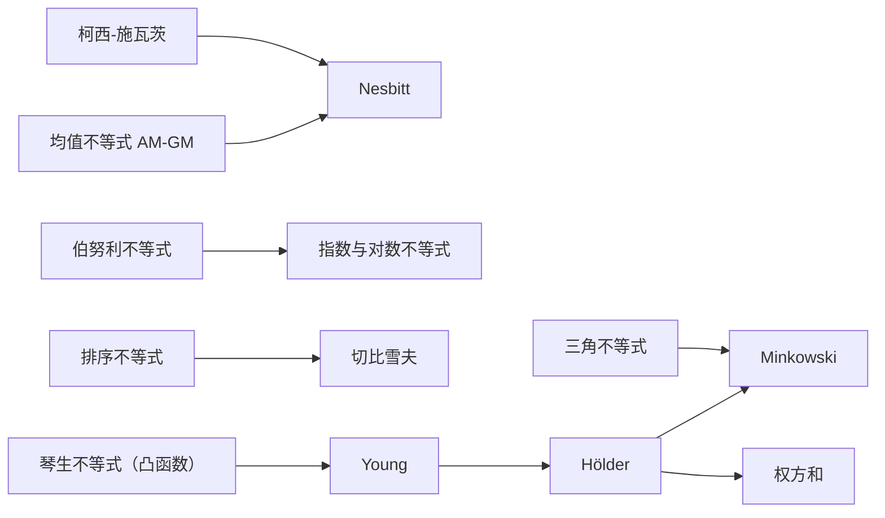

# 不等式

> 本专题按 **「简述 → 证明 → 多视角 → 应用」** 四段组织：先在总览中一览全部不等式，再按依赖顺序逐个详细证明，然后换镜头理解直觉，最后落到应用场景；末尾以**口诀速记**收拢记忆，并以**分层习题**检验掌握（[习题章](inequalities/06-exercises.md)）。
> 建议完成[基础概念（界与函数）](functions-and-bounds.md)和高数第2章（导数与微分）后开始学习。
> 导航：[MOC - math](../../notes/MOC%20-%20math.md) · 配套模板：[cornell-note](../../templates/cornell-note.md)、[book-chapter](../../templates/book-chapter.md) · [章节导航](#章节导航)在总览表之后

> 🚪 **入门阅读路径（第一次读建议走这条）**
> 1. **先建直觉**：[实际场景](inequalities/05-applications.md#从实际问题理解不等式)——7 个生活例子（平均速度、涨跌、用电、资源分配…），先知道“不等式在说什么”；
> 2. **读总览**：回到下面的[全部不等式一览](#一总览所有不等式简述)，重点看每条不等式的**含义**与**取等条件**，暂时跳过证明；
> 3. **看证明**：[证明篇](inequalities/01-basics.md#二证明基础不等式)——理解结论是怎么来的；
> 4. **进阶（第二遍再读）**：[多视角](inequalities/04-multiview.md#五多视角理解向量矩阵几何物理)的向量·矩阵·物理拓展与[积分形式](inequalities/05-applications.md#积分形式)。

读每条不等式时，先问三个问题：**固定了什么？比较的是什么？怎样才能取等？** 例如 AM-GM 比较的是“总和固定时的乘积”，取等意味着分配均衡；柯西比较的是“长度固定时的内积”，取等意味着方向匹配。不等式既给出边界，也常常告诉你达到边界的方法。

## 一、总览：所有不等式简述

**阅读路线**：

1. **简述**（本部分）：依赖关系图 + 全部不等式一张表，先建立全局印象；
2. **证明**（[二](inequalities/01-basics.md#二证明基础不等式)、[三](inequalities/02-core-tools.md#三证明核心工具不等式)、[四](inequalities/03-advanced.md#四证明高阶不等式)）：按依赖顺序逐个详细证明；
3. **多视角理解**（[五](inequalities/04-multiview.md#五多视角理解向量矩阵几何物理)）：用向量·矩阵·几何·物理四个透镜重看每个不等式；
4. **应用**（[六](inequalities/05-applications.md#六应用)）：先用平均速度、涨跌、用电与资源分配建立直觉，再看函数估计、积分形式（四件套）、题型速查；
5. **口诀速记**（[七](#七口诀速记)）：把结构、时机、取等压缩成可背诵的记忆层——**放在文末，第二遍 / 考前复盘用**；
6. **习题**（[八](inequalities/06-exercises.md#八习题分层自测)）：A/B/C 三组分层自测，题后给提示、详解统一放最后。

**符号与前置概念**（正文反复用到，先混个眼熟，遇到再回查）：

| 记号 | 读法 | 一句话含义 |
|:---:|:---|:---|
| $\sum a_i$、$\prod a_i$ | 求和、连乘 | 把下标 $1,\dots,n$ 的项相加 / 相乘 |
| $\bar a,\ \bar b$ | 算术平均 | $\bar a=\dfrac{a_1+\cdots+a_n}{n}$，可看作数据的“重心” |
| $\overline{ab}$ | 乘积的平均 | 先逐项相乘 $a_ib_i$，再对 $i$ 取平均 |
| $\operatorname{Cov}(a,b)$ | 样本协方差 | $\overline{ab}-\bar a\,\bar b$，衡量两组数“同涨同跌”的程度；同序为正、反序为负（详见[多视角 §3](inequalities/04-multiview.md#3-协方差非负性代数本质)） |
| $\tilde a$ | 中心化向量 | 逐个减去均值：$\tilde a_i=a_i-\bar a$，只留下“起伏” |
| $\lVert a\rVert_p$ | 范数（长度） | 向量的“长度”，如 $\lVert a\rVert_2=\sqrt{\sum a_i^2}$ |
| $a\propto b$ | 成比例 | $a=\lambda b$，方向相同（$\lambda>0$）或相反（$\lambda<0$） |
| $\rho$ | 相关系数 | 归一化后的协方差，满足 $\lvert\rho\rvert\le 1$ |

**依赖关系图**（箭头方向 = 前驱 $\to$ 后继，例如"切比雪夫由排序不等式推出"）：



**全部不等式一览**（证明顺序即阅读顺序，详见列指向所在部分）：

| # | 不等式 | 陈述 | 取等条件 | 一句话本质 | 详见 |
|:---:|:---|:---|:---|:---|:---:|
| 1 | 三角不等式 | $\lvert a+b\rvert \le \lvert a\rvert+\lvert b\rvert$ | $ab\ge 0$ | 任意范数下，绕行不划算 | [证明](inequalities/01-basics.md#三角不等式绝对值不等式) · [多视角](inequalities/04-multiview.md#多视角三角不等式) |
| 2 | 均值不等式（AM-GM） | $\sqrt[n]{a_1\cdots a_n} \le \dfrac{a_1+\cdots+a_n}{n}$（$a_i\ge 0$） | 全部相等 | 总量固定，均衡时乘积（体积）最大 | [证明](inequalities/01-basics.md#均值不等式) · [多视角](inequalities/04-multiview.md#多视角均值不等式am-gm) |
| 3 | 排序不等式 | 逆序和 $\le$ 乱序和 $\le$ 同序和 | 每个逆序对都"捆绑"（一侧相等） | 同序匹配总产出最大，错配损失 = 双差乘积 | [证明](inequalities/01-basics.md#排序不等式) · [多视角](inequalities/04-multiview.md#多视角排序不等式) |
| 4 | 切比雪夫不等式 | $\bar a\,\bar b \le \overline{ab}$（同序时，均值的乘积 $\le$ 乘积的均值） | 任一组全相等 | 同序 $\Rightarrow$ 协方差非负 | [证明](inequalities/01-basics.md#切比雪夫不等式) · [多视角](inequalities/04-multiview.md#多视角切比雪夫不等式) |
| 5 | 柯西-施瓦茨 | $\bigl(\sum a_ib_i\bigr)^2 \le \bigl(\sum a_i^2\bigr)\bigl(\sum b_i^2\bigr)$ | $a \propto b$ | 功 $\le$ 力 $\times$ 位移；投影 $\le$ 模长；$\lvert\rho\rvert\le 1$ | [证明](inequalities/02-core-tools.md#柯西-施瓦茨不等式) · [多视角](inequalities/04-multiview.md#多视角柯西-施瓦茨不等式) |
| 6 | 伯努利 | $(1+x)^r \ge 1+rx$（$x>-1$，$r$ 为正整数） | $r=1$ 或 $x=0$ | 切线在凸曲线下方；单利 $\le$ 复利 | [证明](inequalities/02-core-tools.md#伯努利不等式) · [多视角](inequalities/04-multiview.md#多视角伯努利不等式) |
| 7 | 琴生 | $f\bigl(\sum\lambda_ix_i\bigr) \le \sum\lambda_if(x_i)$（$f$ 凸） | 全部相等（严格凸时） | 质心不会跳出凸图形；$x^2$ 特例 = 平行轴定理 | [证明](inequalities/02-core-tools.md#琴生不等式) · [多视角](inequalities/04-multiview.md#多视角琴生不等式) |
| 8 | Nesbitt | $\sum\limits_{cyc}\dfrac{a}{b+c} \ge \dfrac32$（$a,b,c>0$） | $a=b=c$ | $\tfrac32$ 是最均衡状态的最低消费 | [证明](inequalities/02-core-tools.md#nesbitt-不等式) · [多视角](inequalities/04-multiview.md#多视角nesbitt-不等式与-titu-引理) · [Titu 引理](inequalities/02-core-tools.md#附titu-引理engel-形式详解) |
| 9 | Young | $ab \le \dfrac{a^p}{p}+\dfrac{b^q}{q}$（$a,b\ge0$；$p,q>1$，$\tfrac1p+\tfrac1q=1$） | $a^p=b^q$ | $L^p$–$L^q$ 对偶的单点版：预算由两种范数分摊 | [证明](inequalities/03-advanced.md#young-不等式) · [多视角](inequalities/04-multiview.md#多视角young-不等式) |
| 10 | Hölder | $\sum a_ib_i \le \bigl(\sum a_i^p\bigr)^{1/p}\bigl(\sum b_i^q\bigr)^{1/q}$（$a_i,b_i\ge0$，共轭指数 $p,q>1$） | 非零时 $a_i^p \propto b_i^q$；任一组全零也取等 | 耦合效应 $\le$ 容量之积（$L^p$–$L^q$ 对偶） | [证明](inequalities/03-advanced.md#hölder-不等式) · [多视角](inequalities/04-multiview.md#多视角hölder-不等式) |
| 11 | 权方和 | $\sum\dfrac{a_i^{p+1}}{b_i^p} \ge \dfrac{(\sum a_i)^{p+1}}{(\sum b_i)^p}$（$a_i,b_i,p>0$） | $\dfrac{a_i}{b_i}$ 全相等 | 并联电路最小功耗：按容量分流；分开除比合并除贵 | [证明](inequalities/03-advanced.md#权方和不等式) · [多视角](inequalities/04-multiview.md#多视角权方和不等式) |
| 12 | Minkowski | $\lVert a+b\rVert_p \le \lVert a\rVert_p+\lVert b\rVert_p$（$1\le p<\infty$） | $p>1$：同向成比例或有零向量；$p=1$：逐项 $a_ib_i\ge0$ | 单位球凸 $\Leftrightarrow$ 三角不等式成立 | [证明](inequalities/03-advanced.md#minkowski-不等式) · [多视角](inequalities/04-multiview.md#多视角minkowski-不等式) |
| 13 | 指数与对数 | $e^x\ge 1+x$；$\dfrac{x-1}{x}\le\ln x\le x-1$ | $x=0$ / $x=1$ | 切线界；KL 散度非负：信息不无中生有 | [应用](inequalities/05-applications.md#指数与对数不等式) · [多视角](inequalities/04-multiview.md#多视角指数与对数不等式) |
| 14 | 三角函数 | $\sin x<x<\tan x$（$0<x<\pi/2$）；Jordan：$\tfrac{2}{\pi}x\le\sin x\le x$（$0\le x\le\pi/2$） | 严格式无等号；Jordan 见正文端点条件 | 单位圆面积序；大角度单摆变慢 | [应用](inequalities/05-applications.md#三角函数不等式) · [多视角](inequalities/04-multiview.md#多视角三角函数不等式) |
| 15 | 积分形式（四件套） | C-S / 琴生 / Hölder / Minkowski 的"和式 $\to$ 积分"版本 | 与离散版一致 | 函数 = 无穷维向量，同一套几何 | [应用](inequalities/05-applications.md#积分形式) · [多视角](inequalities/04-multiview.md#多视角积分形式) |

---

## 章节导航

> 证明、多视角、应用与习题分居六章（`topics/math/inequalities/`）。**编号对照**：本文节号 **二 / 三 / 四 / 五 / 六 / 八** 分别对应章节文件 **01 / 02 / 03 / 04 / 05 / 06**（节号一、七留在本页）。口诀速记在文末第七部分，与总览表同页，便于对照背诵。

- 第二部分 · 证明篇①（基础）→ [01-basics](inequalities/01-basics.md)：三角不等式 · 均值（AM-GM）· 排序 · 切比雪夫
- 第三部分 · 证明篇②（核心工具）→ [02-core-tools](inequalities/02-core-tools.md)：柯西-施瓦茨（含 Lagrange 恒等式附录）· 伯努利 · 琴生（含凸函数判定附录）· Nesbitt（含 Titu 引理附录）
- 第四部分 · 证明篇③（高阶）→ [03-advanced](inequalities/03-advanced.md)：Young → Hölder → 权方和 / Minkowski
- 第五部分 · 多视角理解 → [04-multiview](inequalities/04-multiview.md)：向量 · 矩阵 · 几何 · 物理
- 第六部分 · 应用 → [05-applications](inequalities/05-applications.md)：七个实际场景 · 指数与对数 · 三角函数 · 积分四件套 · 题型速查
- 第七部分 · 口诀速记（留在本页）→ [七、口诀速记](#七口诀速记)：总纲三句 · 十五条口诀表 · 均值链专记 · 选工具顺口溜
- 第八部分 · 习题 → [06-exercises](inequalities/06-exercises.md)：A 基础 · B 进阶 · C 考研向 · 答案与详解

---

## 七、口诀速记

> 🎯 定位：复习与考前的**快速回忆层**——建议第一遍学完再回来看。每条口诀编码三件事——**结构长什么样、什么时候用、取等在哪里**；理解与证明回到前面各部分。配套检验见[八、习题](inequalities/06-exercises.md#八习题分层自测)：先背口诀，再做题，错了回这里对号入座。

### 总纲：三句口诀管全程

**1. 「一正二定三相等」**——均值类工具上桌前的资格检查：各项为**正**、和或积为**定**值、等号**取得到**。三条缺一，先变形再动手（习题 [A1](inequalities/06-exercises.md#答案与详解)、[A2](inequalities/06-exercises.md#答案与详解) 是两个标准失效案例：范围不含取等点、变量为负）。

**2. 「先认结构，再选工具，最后查等号」**——解题顺序不要倒过来：从"待证式长什么样"（平方和？分式和？乘积？幂与一次式？）反推工具（见[选工具顺口溜](#选工具顺口溜)），工具选定后**立刻写出取等条件**，最后代回验证。

**3. 「大边缩、小边放，朝着目标走」**——放缩方向：要证 $A\ge B$，可以把 $A$ 换成更小但好算的 $A'$（证 $A\ge A'\ge B$），或把 $B$ 换成更大但好算的 $B'$（证 $A\ge B'\ge B$）；两边同时换就是夹逼。**每次放缩后重查等号**：放缩方向若破坏了取等点，界就松了。

### 十五条口诀表

> 编号与[总览一览表](#一总览所有不等式简述)一致，可对照"一句话本质"服用。

| # | 不等式 | 口诀 | 拆解（结构 → 时机） | 取等提醒 |
|:---:|:---|:---|:---|:---|
| 1 | 三角 | **同号直达，异号绕行** | $\lvert a\rvert+\lvert b\rvert \ge \lvert a+b\rvert$；误差合并、模长估计 | $ab\ge 0$（同号） |
| 2 | 均值 AM-GM | **和定积最大，积定和最小** | 固定总量求乘积上界；固定乘积求和下界 | 全部相等；先查"一正二定" |
| 3 | 排序 | **大配大、小配小，同序产出最高** | 两组同增数组配对求乘积和最值 | 无逆序对（捆绑相等） |
| 4 | 切比雪夫 | **同涨同跌，均值放大** | 同序时：乘积的均值 $\ge$ 均值的乘积 | 任一组全相等 |
| 5 | 柯西 | **乘积和的平方，装进平方和的乘积** | 见"平方和""内积""投影"字样 | $a\propto b$（成比例） |
| 6 | 伯努利 | **一次切线是底线** | 幂式 $\ge$ 一次式；$(1+x)^r\ge 1+rx$ | $x=0$（或 $r=1$） |
| 7 | 琴生 | **凸则先混后算更省** | $f$ 凸：$f(\text{加权平均})\le\text{加权的} f$；平均处求界 | 各点相等 |
| 8 | Nesbitt | **轮换分式找 $\tfrac32$** | $\sum a/(b+c)$ 型轮换分式和 | $a=b=c$ |
| 9 | Young | **你 $p$ 我 $q$，倒数和一；乘积不超，两项分摊** | 乘积式拆成两个幂项之和 | $a^p=b^q$ |
| 10 | Hölder | **柯西升级，容量罩耦合** | 指数不是 2 的"广义柯西" | $a_i^p\propto b_i^q$ |
| 11 | 权方和 | **分开除贵，合并除省** | $\sum a^{p+1}/b^p$ 型分式和求下界 | $a_i/b_i$ 全相等 |
| 12 | Minkowski | **先加后量，不超先量后加** | 范数三角不等式；$L^p$ 估计 | 同向成比例（$p=1$ 逐项同号即可，见正文） |
| 13 | 指对 | **$e^x$ 压着 $1+x$，$\ln$ 夹在两线之间** | 指对式放缩、重要极限的夹逼 | $x=0$ / $x=1$ |
| 14 | 三角函数 | **弦不过弧，弧不过切** | $0<x<\pi/2$ 的 $\sin/\tan$ 估计；大角度用 Jordan | 开区间严格无等号 |
| 15 | 积分形式 | **$\sum$ 换 $\int$，结论照搬** | 定积分估计，先写离散版再平移 | 与离散版一致 |

### 均值链专记

均值链（二变量版）从大到小：

$$\underbrace{\sqrt{\frac{a^2+b^2}{2}}}_{\text{平方 }Q} \;\ge\; \underbrace{\frac{a+b}{2}}_{\text{算术 }A} \;\ge\; \underbrace{\sqrt{ab}}_{\text{几何 }G} \;\ge\; \underbrace{\frac{2}{\frac1a+\frac1b}}_{\text{调和 }H}$$

- **背法**：「**方算几调，越高越大**」——从左到右依次是平方、算术、几何、调和平均，位置越高值越大（$a=b$ 时四者相等）。
- **哪个场景用哪个**（对应[应用场景](inequalities/05-applications.md#从实际问题理解不等式)）：波动/标准差场景用**方**（RMS）；日常"平均"是**算**；增长率、利率场景用**几**（几何平均）；速度、并联电阻场景用**调**（调和平均）。
- **「和定积最大，积定和最小」微型例**：$x+y=10 \Rightarrow xy\le 25$（$x=y=5$）；$xy=16 \Rightarrow x+y\ge 8$（$x=y=4$）。两者都只在**均衡点**取等——这正是"总量固定，均衡最优"的口诀来源。
- **常用变形**（看到就应认出）：$\dfrac xa+\dfrac ax\ge 2$；$ab\le\left(\dfrac{a+b}2\right)^2$；$a^2+b^2\ge 2ab$。

### 选工具顺口溜

> 每句对应[题型速查](inequalities/05-applications.md#题型速查)的一行，做题时"从特征到工具"一秒定位：

```text
见到平方和，柯西先出手；
分式和下界，权方和去收；
乘积拆上界，Young 两头分；
幂式比一次，伯努利打底；
凸函数求平均，琴生一步走；
同序乘积和，排序切比雪夫；
和积要转化，均值三查够；
积分来估计，和式搬进 ∫。
```

最后一句的"三查"=「一正二定三相等」；倒数第二句"同序乘积和"：问**重新配对**的极值用排序不等式；数据**已同序配好**、比较"乘积的均值"与"均值的乘积"用切比雪夫（两者都以同序为前提）。
